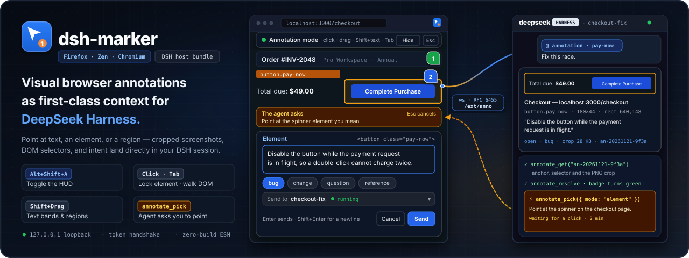
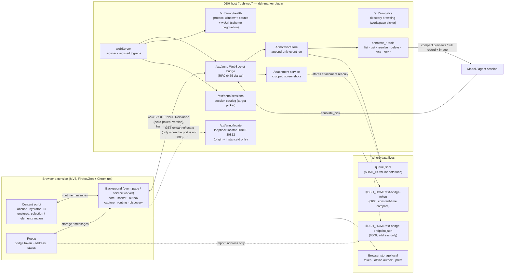

# dsh-marker

[](https://github.com/modenicheng/dsh-annotate/actions/workflows/ci.yml)
[](LICENSE)

[English](README.md) · [简体中文](README.zh-CN.md)

dsh-marker lets you point at part of a web page and hand it to
[DeepSeek Harness](https://github.com/deepseek-ai/deepseek-harness) (DSH) as
context for your conversation — with a cropped screenshot and the page
information around it, not just a pasted URL.

It is one product in two pieces, and you install both:

1. **The DSH plugin** (`dsh-marker` on npm). This is the half that receives
   and stores annotations and gives your DSH sessions the `annotate_*` tools.
   You install it with one `dsh` command.
2. **The browser extension**. This is the half you use day to day. Press a
   shortcut, mark text, an element, or a region of any page, optionally write
   a comment, and send it. Firefox, Zen, and Chromium-based browsers are
   supported.

What happens on the way: the extension talks only to the DSH instance on the
same machine (`127.0.0.1`), the annotation lands in the DSH Web UI as a chip
in the composer of the session you chose — visible, removable, and never sent
to the model until you send the message that carries it. The model can also
turn the flow around and ask you to point at something (`annotate_pick`): a
banner appears on the page and waits for your click.

Nothing leaves the machine: no account, no telemetry, no developer server.
What the extension reads and what is stored where is the privacy policy:
[docs/privacy.md](docs/privacy.md).

> **Status.** 1.0.0 is the first public release (2026-11-21). The Edge
> Add-ons and Mozilla Add-ons listings are live (Step 2 links both); the
> Chrome Web Store listing is submitted and under review at the time of
> writing, so Chrome and the other Chromium browsers install manually from a
> GitHub Release below until that listing clears review. Capture and delivery
> are verified in a real Firefox; the Chromium build passed an early bring-up
> but has not been re-tested end to end, and Zen and the DSH Desktop app
> still need their verification runs. Details and acceptance criteria:
> [docs/PLAN.md](docs/PLAN.md).

If an AI agent is setting this up for you, there is a runbook written for it:
[docs/AGENT-INSTALL.md](docs/AGENT-INSTALL.md).

## What you need first

| You need | Why |
|---|---|
| DSH 0.2 or newer, with the Web profile (`dsh web`) or the Desktop app | The plugin attaches to the DSH host's webserver; the extension connects to it there. |
| Node.js 22 or newer | DSH runs on Node. Nothing in this project is built or compiled on your machine. |
| Firefox 128+, Zen, or a Chromium browser (Chrome, Edge 88+, Brave, Vivaldi, Opera, Arc) | For the browser half. |
| Both halves on the same machine | The extension connects to `127.0.0.1` only — it cannot reach a DSH instance on another computer. |

A note on two words used throughout:

- A **profile** is a named DSH configuration (its plugins, settings, and
  sessions live under their own directory). `dsh web` boots the profile named
  `web`, which serves the Web UI. If you use another profile, add
  `--profile <name>` to the `dsh` commands below.
- **`$DSH_HOME`** is DSH's data directory: `~/.dsh` on Linux and macOS,
  `%USERPROFILE%\.dsh` on Windows. Two files there matter for setup.

## Install

Three steps: the plugin into DSH, the extension into the browser, then one
token to connect them.

### Step 1 — Install the DSH plugin

The plugin is an ordinary DSH plugin package, published on npm as `dsh-marker`:

```sh
dsh plugin add dsh-marker
```

Add `--profile <name>` (before `add`) to install into a specific profile. The
command downloads the package and its one dependency (`ws`) from the npm
registry, so the machine needs the registry reachable this once. DSH checks
its own version against the plugin's requirement before installing.

Then start DSH as you normally do — `dsh web`, or the Desktop app — on the
profile you installed into. Two things tell you it worked:

- `dsh-marker` shows up on the **Plugins** page of the Web UI, enabled. (If
  the row is there but inactive, switch it on on the same page. The page's
  **Add plugin** button can also install a package directly, if you prefer
  the GUI over the command line.)
- The first start writes the file `$DSH_HOME/ext-bridge-token` — a long
  random string. That is the token the extension will ask for in Step 3.

Later updates: `dsh plugin update dsh-marker` (the **Plugins** page offers
the same). Keep the plugin and the extension roughly in step — see
[Troubleshooting](#troubleshooting) for what happens on a version mismatch.

### Step 2 — Install the browser extension

Download the package for your browser from the current release (built and
checksummed by CI; nothing is built locally):

| For | Package (v1.0.0) |
|---|---|
| Firefox / Zen | [dsh-marker-firefox-1.0.0.zip](https://github.com/modenicheng/dsh-annotate/releases/download/v1.0.0/dsh-marker-firefox-1.0.0.zip) |
| Chromium browsers | [dsh-marker-chromium-1.0.0.zip](https://github.com/modenicheng/dsh-annotate/releases/download/v1.0.0/dsh-marker-chromium-1.0.0.zip) |
| Both, checksums | [checksums.txt](https://github.com/modenicheng/dsh-annotate/releases/download/v1.0.0/checksums.txt) |

Verify before installing: `sha256sum -c checksums.txt --ignore-missing`
(macOS: `shasum -a 256 -c checksums.txt`; Windows:
`certutil -hashfile <file> SHA256`). Newer releases use the same file names
with the version replaced — see [Releases](https://github.com/modenicheng/dsh-annotate/releases).
**Firefox and Edge users** can install from their store instead —
[Mozilla Add-ons](https://addons.mozilla.org/firefox/addon/dsh-marker/)
for Firefox, the
[Edge Add-ons listing](https://microsoftedge.microsoft.com/addons/detail/bibpceooggdfoelohhjegicfpilafnec)
for Edge: permanent, auto-updating, none of the download or manual steps
below needed. The same becomes true for the other Chromium browsers once the
Chrome Web Store listing goes live.

For a manual install, unzip the package and follow the branch for your
browser.

#### Firefox / Zen

**Firefox**: install from
[Mozilla Add-ons](https://addons.mozilla.org/firefox/addon/dsh-marker/) — a
normal store install with automatic updates — and skip the rest of this
section. Zen is unverified either way; the manual route follows.

Release Firefox installs only add-ons signed by Mozilla, and the release zip
is unsigned — so it loads as a **temporary add-on**:

1. Open `about:debugging#/runtime/this-firefox` (Zen: `about:debugging`).
2. **Load Temporary Add-on…** → pick the unzipped folder's `manifest.json`.

A temporary add-on disappears when the browser exits; after a restart, load
it again the same way. One other permanent route exists:

- Firefox Developer Edition, Nightly, or ESR: set
  `xpinstall.signatures.required` to `false` in `about:config`, rename the
  zip to end in `.xpi`, then `about:addons` → gear menu → **Install Add-on
  From File…**.

#### Chromium (Chrome, Edge, Brave, Vivaldi, Opera, Arc)

**Edge**: install from the
[Edge Add-ons listing](https://microsoftedge.microsoft.com/addons/detail/bibpceooggdfoelohhjegicfpilafnec)
and skip the two steps below. If `Alt+Shift+A` does nothing after installing,
set it once in `edge://extensions/shortcuts` as in step 2. Other Chromium
browsers, while the Chrome Web Store listing is in review:

1. Open `chrome://extensions`, enable **Developer mode**, choose **Load
   unpacked**, and select the unzipped folder. The extension survives
   browser restarts. The costs: the browser keeps a developer-mode notice,
   and updates are manual — download the next release and replace the folder.
2. **Set the keyboard shortcut by hand** — this step decides whether
   screenshots work. Open `chrome://extensions/shortcuts`, find **Annotate
   the current page**, and assign `Alt+Shift+A` (or your preferred
   combination). Chromium does not let an extension register its own
   shortcut, and only a browser-registered shortcut grants `activeTab` — the
   browser's permission to capture the visible tab. Without it, annotate
   mode still works, but marks are sent without their screenshot. The
   popup's **Annotate this page** button is the one path that always gets
   the permission.

#### From source (development)

`packages/extension` in this repository *is* the extension — no build step,
no bundler, no dependencies. Load its `manifest.json` as a temporary add-on
as above. See [Development](#development) for the rest of the workflow.

### Step 3 — Connect the two

1. Click the dsh-marker icon in the browser toolbar. The popup opens.
2. Open `$DSH_HOME/ext-bridge-token` in any text editor and paste its
   content into the popup's **Token** field. Treat the token like a local
   password: anyone who can read it can send things to your DSH host, so
   keep it out of chats and screenshots.
3. Leave **Connection** on **Automatic** and the address at its default
   (`127.0.0.1`, port `3080`), and press **Save and connect**. Automatic
   also finds hosts whose port is not 3080 — the DSH Desktop app picks a
   fresh port at every launch, and the extension still finds it. Manual
   address entry is only for non-default setups (remote hosts, reverse
   proxies): [docs/DEPLOYMENT.md](docs/DEPLOYMENT.md).
4. Done when the popup's status line reads **Connected** next to the host
   address.

## Using it

1. On any page, press `Alt+Shift+A` (macOS: `Option+Shift+A`; configurable in
   the popup). A small bar appears at the top: **Annotation mode**.
2. Mark something — the bar shows the three gestures:
   - **text**: hold `Shift` and drag across a paragraph;
   - **element**: just click it; while it is outlined, `Tab` widens the
     selection to its parent element one step at a time and `Shift+Tab`
     steps back down — click locks whatever level is outlined;
   - **region**: drag a rectangle.
3. A small composer opens. Write a comment if you have one (empty is fine —
   the mark alone is a complete annotation), pick the destination under
   **Send to** (the default is the session the DSH window is currently
   showing; **＋ New session** starts a fresh one), and press Enter.
4. In the DSH Web UI, the annotation appears as a chip in that session's
   composer. Hovering the chip (or a chip in a sent message) opens a card
   with the cropped screenshot, the page, and your comment. The message goes
   to the model only when you send it — the chip is yours to delete.
5. `Esc` leaves annotate mode; a right-click does too, unless turned off in
   the popup. Marks made while the host is unreachable are queued in the
   browser and sent when it is back (the popup shows the count).

From the other side, the model has the six tools listed
[below](#tools); the one you will notice is `annotate_pick`, a banner on the
page asking you to point at something. The popup's **This page** section
lists the current page's annotations with **Resolve** / **Reopen** /
**Delete**, matching what the tools do.

## The popup, field by field

**Annotate**

| Control | What it does |
|---|---|
| Shortcut | Records a new combination. On Firefox this also updates the browser command, keeping screenshots working. On Chromium the browser command must be assigned in `chrome://extensions/shortcuts` (Step 2); keep both on the same keys, or use **Annotate this page**. |
| Exit annotate mode after sending | Off by default, so you can mark several places in one go. |
| Right-click leaves annotate mode | On by default. |
| Annotate this page | Enters annotate mode right now; always receives the screenshot permission, even on a tab that was open before the extension was installed. |

**Connection settings**

| Control | What it does |
|---|---|
| Connection: Automatic / Manual | Automatic (default) finds the running host on its own — including hosts on non-default ports. Manual uses exactly the address below. |
| Host or URL + Port | Usually left at the defaults. A full URL such as `wss://anno.example.com` is for hosts behind HTTPS; if you type no scheme, the host decides `ws` vs `wss` itself. |
| Import endpoint file… | Reads the address out of `$DSH_HOME/ext-bridge-endpoint.json`, which the host rewrites on every start. Address only — the file never contains the token. |
| Token | The content of `$DSH_HOME/ext-bridge-token`, pasted once. |
| Send queued marks | Force-sends the outbox — marks captured while the host was unreachable, with their screenshots. |

**This page** lists the page's annotations (state, age, resolve / reopen /
delete), and the bottom status line shows the connection state, the connected
address, and the outbox count. The popup follows the browser's UI language;
English and Simplified Chinese ship today.

## Troubleshooting

- **Popup says *Cannot reach the host*.** Is DSH running, on the profile you
  installed the plugin into? Press **Scan again**; if nothing answers,
  **Import endpoint file…** with `$DSH_HOME/ext-bridge-endpoint.json`, or
  switch to Manual and type the address. Details:
  [docs/DISCOVERY.md](docs/DISCOVERY.md).
- **Token rejected or missing.** Copy `$DSH_HOME/ext-bridge-token` again —
  the file appears on the first host start with the plugin enabled. Only one
  DSH profile should run the bridge at a time.
- **Chromium: marks arrive without screenshots.** The browser shortcut from
  Step 2 is missing, or the popup's recorded key differs from the one
  registered in `chrome://extensions/shortcuts`. Make them identical, or use
  **Annotate this page**.
- ***The extension did not answer*** (after using **Annotate this page**):
  the popup is newer than the extension loaded in this browser session.
  Click **Reload** in `about:debugging` and refresh the page.
- **The extension vanished after a browser restart** (Firefox): expected for
  a temporary add-on — reload it from `about:debugging`, or switch to one of
  the permanent routes in Step 2.
- **Version mismatch between the halves.** The connection negotiates a
  protocol window, and small gaps are tolerated by design; but if the popup
  says one half is too old for the other, update both — `dsh plugin update
  dsh-marker` and the latest extension release.

## Tools

The plugin registers six tools — functions the model can call in a DSH
session. All of them operate on the annotation store and broadcast changes
back to connected browsers.

| Tool | What it does |
|---|---|
| `annotate_list` | List annotations, default `open`, with `status`, `url_filter`, `kind`, and `limit` filters. Returns compact previews. |
| `annotate_get` | Read one annotation by `id` (or `latest`): full anchor JSON plus the cropped screenshot as an image block. |
| `annotate_resolve` | Mark an annotation `resolved` or `wont_fix` with a note the page badge shows, and optionally record `files_touched`. |
| `annotate_delete` | Delete annotations outright by `ids`: the record, its crop, and its badge all go away. For noise that was never meant to be kept; prefer `annotate_resolve` when the work was actually done. |
| `annotate_pick` | Ask the user to point at something in the browser; the call waits (5 s–15 min, default 2 min) for a selection, element, or region. |
| `annotate_clear` | Bulk-delete annotations by `status` and/or `before_iso`. |

## Security model

The bridge — the websocket the extension and the host share — is local-only
by design:

- **No public port by default.** It attaches to the DSH host webserver, which
  binds to `127.0.0.1` by default. Putting that webserver behind a tunnel or
  reverse proxy makes the websocket reachable wherever that server is, so
  terminate TLS in front of it, do not log frames, and keep the port off
  `0.0.0.0`.
- **Token handshake.** The first frame must be `hello { token, version }`.
  The token is 32 random bytes as hex, stored in `$DSH_HOME/ext-bridge-token`
  with owner-only permissions on POSIX, and compared in constant time. A
  client that does not authenticate within 5 seconds is disconnected.
- **No token, no data.** Without a valid token the host closes the socket;
  the only anonymous endpoint is `/ext/anno/health`, which reports the
  protocol window and counts — never annotation content.
- **The web UI routes sit behind DSH's own protections** (Host/Origin checks
  and the browser session the page already holds). The token is never in
  them: the web page is a different trust anchor from the extension.
- **Protocol versions negotiate a window**, not one exact number: the host
  accepts `MIN_PROTOCOL ≤ version ≤ PROTOCOL_VERSION` (both are 1 today), so
  a wire change can ship without disconnecting every installed extension at
  once. A mismatch is reported with both numbers.
- **Discovery publishes an address, not a secret.** A host on a non-default
  port answers one loopback lookup with its current origin and a per-process
  id; it returns no token and no annotation data, and refuses a `Host` that
  is not loopback.
- **Bounded input.** Frames are capped at 32 MiB, records are validated
  against `packages/protocol/src/index.js`, and the store only keeps
  references to screenshots that DSH's own attachment service accepts.
- **Local storage.** Annotations live under `$DSH_HOME`; nothing leaves the
  machine and there is no telemetry.

The practical trust boundary: anyone who can read
`$DSH_HOME/ext-bridge-token` or write to your profile directory can already
act as you locally.

## Where data lives

| Location | Contents |
|---|---|
| `$DSH_HOME/annotations/queue.jsonl` | Append-only event log (`put`, `patch`, `del`, `img`), folded in memory at startup and compacted when it grows stale. |
| DSH attachment service | Cropped screenshots; the log stores only the attachment reference. |
| `$DSH_HOME/annotations/pending-mentions.json` | Annotations queued for a session's composer that has not read them yet. |
| `$DSH_HOME/annotations/focus.json` | Which session the web UI is currently showing (expires after six hours). |
| `$DSH_HOME/ext-bridge-token` | Bridge token, generated on first use with mode `0600`. |
| `$DSH_HOME/ext-bridge-endpoint.json` | The listening origin, `instanceId`, profile label, and timestamps — address only, no token, written atomically on every start. |
| Browser `storage.local` | Extension token, offline outbox, UI preferences, and the endpoint the host advertised last. Details: [docs/privacy.md](docs/privacy.md#what-is-stored-in-the-browser). |

`$DSH_HOME` is shared by every profile on the machine, so one token works
for whichever profile is running — but only one profile should run the bridge
at a time.

## Architecture



There is no extra daemon, and on the default deployment no extra port. The
bridge is mounted on the DSH host webserver and lives exactly as long as the
host does. A host whose port is not `3080` also opens one small loopback
*locator* — a single-purpose address lookup, carrying no annotation data —
so a browser can find it. Both halves are plain ESM JavaScript with no build
step.

Non-default deployments — Desktop's moving port, TLS, reverse proxies — are
covered in [docs/DEPLOYMENT.md](docs/DEPLOYMENT.md); the discovery design and
rationale are in [docs/DISCOVERY.md](docs/DISCOVERY.md).

## Development

Work in an isolated `anno` profile, and install the plugin from this checkout
instead of the registry:

```sh
# 1. Create the isolated profile from the shipped Web template (once).
#    It initialises the profile before booting it; Ctrl+C if port 3080 is busy.
dsh --profile anno --from-default-profile web

# 2. Install the plugin from this checkout (a local directory, no registry).
dsh plugin --profile anno add /absolute/path/to/dsh-annotate/packages/plugin

# 3. Boot the profile and open the Web UI address it prints.
dsh --profile anno
```

On Windows use the same commands in PowerShell, with a Windows path such as
`D:\coding\dsh-annotate\packages\plugin`.

```sh
pnpm run sync-protocol                              # copy the protocol into both consumers
node --test "packages/*/test/*.test.js"             # works in PowerShell and cmd
pnpm run check                                      # Biome + sync + syntax + tests
node scripts/smoke-ws.mjs ws://127.0.0.1:3080/ext/anno   # verify a booted bridge, no browser needed
node scripts/smoke-discovery.mjs                    # verify the record + locator of a --port 0 host
```

`smoke-ws.mjs` drives the real socket end to end (health probe, token
handshake, create → query → resolve, idempotent replay); run it after
installing the plugin and after any protocol change. `smoke-discovery.mjs`
is its discovery counterpart against a `dsh --profile anno --port 0` host.
The quoted glob is intentional: Node expands it itself, which keeps the
command identical on Windows, macOS, and Linux. Biome is a pinned
devDependency: after one `pnpm install`, `pnpm run check`, the hooks, and
the tests all run offline.

The extension's `_locales/` localizes only the manifest metadata (the store
name and description); the interface strings come from the built-in bilingual
tables in `src/content/ui/strings.js` and `src/shared/popup-strings.js`, not
from `_locales/`.

The two store targets are generated from one source tree for local QA —
`node scripts/build-extension.mjs` writes `dist/firefox` and `dist/chromium`.
A local build is for testing only: the packages a store receives are built by
CI from the release tag ([docs/DISTRIBUTION.md](docs/DISTRIBUTION.md) §4.4),
and the manual install in Step 2 downloads those same CI bytes — never a
local build.

First checkout (hooks, generated files, commit format):
[CONTRIBUTING.md](CONTRIBUTING.md).

## Status and roadmap

| Phase | Scope | State |
|---|---|---|
| M0 | Protocol, repository base, CI, hooks | done |
| M1 | Host plugin, storage loop, tools | done, verified against a live host |
| M2 | Extension capture: gestures, overlay, crop, outbox | done; verified in Firefox, Chromium QA pending |
| M3 / M3.5–M3.8 | Re-anchoring, picks, `dsh-anno:` mentions, chip hover card, push delivery | done; Firefox-verified, Zen pending |
| M4 | Developer context, session routing, multi-window | planned |
| M4.5 | Discovery: Desktop's moving port, endpoint record, loopback locator | delivered; Desktop run pending (M4.5c) |
| M4.6 | Send an annotation into a new session (default / existing / new workspace) | implemented; browser QA pending |
| M4.7 | New-workspace path picking: one flat directory browser over Host-served listings (locations view, breadcrumb, live final path) | implemented (M4.7a/b + M4.7c redesign); browser QA pending (D26) |
| M5 | Signing and distribution | pipeline live (npm, AMO, CWS, Edge lanes); Edge and AMO listings published, CWS in review |

The detailed deliverables and acceptance criteria are in
[docs/PLAN.md](docs/PLAN.md); implementation decisions and their rationale are
in [docs/DECISIONS.md](docs/DECISIONS.md); releases are listed in
[CHANGELOG.md](CHANGELOG.md).

## Documentation

Using dsh-marker:

- [docs/INTERACTION.md](docs/INTERACTION.md) — interaction and capture UX
- [docs/privacy.md](docs/privacy.md) — data handling and privacy
- [docs/DEPLOYMENT.md](docs/DEPLOYMENT.md) — TLS, reverse proxies, Desktop's moving port
- [docs/AGENT-INSTALL.md](docs/AGENT-INSTALL.md) — a runbook for AI agents setting dsh-marker up for a user

Design and internals:

- [docs/DISCOVERY.md](docs/DISCOVERY.md) — discovery design and rationale
- [docs/PLAN.md](docs/PLAN.md) / [docs/DECISIONS.md](docs/DECISIONS.md) — roadmap, decisions

For contributors:

- [CONTRIBUTING.md](CONTRIBUTING.md) — commit format, hooks, generated-file rule
- [docs/DISTRIBUTION.md](docs/DISTRIBUTION.md) / [docs/STORE_LISTING.md](docs/STORE_LISTING.md) — release pipeline, store packaging and listing

## License

MIT — see [LICENSE](LICENSE).
