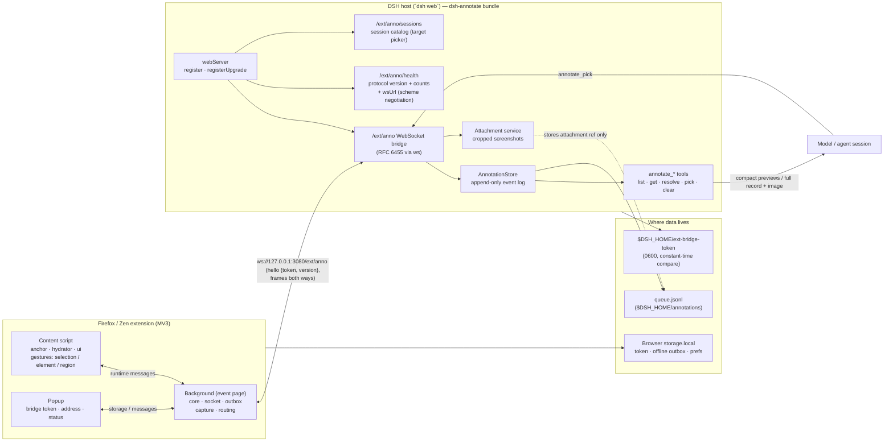

# dsh-annotate

[](https://github.com/modenicheng/dsh-annotate/actions/workflows/ci.yml)
[](LICENSE)

Visual annotations from your everyday browser, as first-class context for
[DeepSeek Harness](https://github.com/deepseek-ai/deepseek-harness) (DSH).

Point at a paragraph, a button, or a region of a page in Firefox or Zen, write
one line of intent, and the annotation lands in the running DSH session with a
cropped screenshot, DOM selectors, and page context. The model can also ask you
to point at something (`annotate_pick`) when a request is ambiguous.

> **Status: early development.** The protocol, the host plugin, and the
> extension are implemented and covered by tests. The host half is verified
> against a live `dsh web` instance, and the extension's bridge connection is
> verified in a real Firefox 159.0 session (token handshake over `ws://127.0.0.1`);
> the capture gestures still need a pass in a real browser. See
> [docs/PLAN.md](docs/PLAN.md) for what is proven and what is not.

## Architecture



There is no extra daemon and no extra port. The bridge is mounted on the DSH
host webserver and lives exactly as long as `dsh web` does. Both sides are plain
ESM JavaScript with no build step.

### `ws://` or `wss://`: the host decides

A stock local install is plain HTTP on loopback, so the extension must reach it
with `ws://` and `http://`. Two things keep that working:

- **The extension's page CSP must not upgrade insecure requests.** Firefox's
  MV3 default extension policy is
  `script-src 'self'; upgrade-insecure-requests;`, and that directive rewrites
  the bridge's `ws://` to `wss://` (and its `http://` health probe to `https://`)
  before any of our code can intervene. `manifest.json` therefore declares an
  explicit `content_security_policy.extension_pages` without it, and
  `node scripts/check-manifest.mjs` fails if that declaration ever disappears or
  brings the directive back.
- **The scheme is negotiated, not guessed.** Before connecting, the extension
  reads `/ext/anno/health`, which reports `secure` and a complete `wsUrl` derived
  from how the request reached the host: a TLS socket or a TLS-configured DSH
  webserver yields `wss://`; a request forwarded by a TLS-terminating reverse
  proxy (with `X-Forwarded-Proto: https`) yields `wss://` too; anything else
  yields `ws://`. On a plain host the probe goes to `http://` and the answer is
  `ws://`, so the default path is unchanged. The extension opens the advertised
  URL and only falls back to the address saved in the popup when the probe
  cannot reach the host at all.

The popup accepts a bare host and port (`127.0.0.1` + `3080`, the pre-existing
shape, kept so old settings keep working) or a whole URL
(`wss://anno.example.com`). A typed scheme is an explicit override for setups
where the probe is unavailable; leaving it out is the normal case.

### Behind an HTTPS reverse proxy

TLS terminates at the proxy, so the proxy must **forward upgrades** and tell the
host the original scheme:

```nginx
location /ext/anno {
  proxy_pass http://127.0.0.1:3080;
  proxy_http_version 1.1;
  proxy_set_header Upgrade $http_upgrade;
  proxy_set_header Connection "upgrade";
  proxy_set_header Host $host;
  proxy_set_header X-Forwarded-Proto $scheme;
  proxy_set_header X-Forwarded-Host $host;
}
```

`X-Forwarded-Proto` is what makes health answer `wss://`; without it the host can
only advertise `ws://`. The upgrade route itself is scheme-independent: it reads
no forwarding header and no `Origin`, so a proxy that terminates TLS is invisible
to the handshake, and the bridge token remains the only admission check. The
extension's `host_permissions` cover loopback only (`http(s)://127.0.0.1/*`,
`ws(s)://127.0.0.1/*`, and the `localhost` forms); a host reached through a
public domain needs that origin added to the manifest before the extension may
probe or connect to it.

## Install

Requirements: Node.js 22+ and a DSH installation with the Web profile. Firefox
128+ or Zen for the extension.

### Host plugin

The host plugin is an ordinary DSH bundle. Its one runtime dependency (`ws`) is
installed into the profile by the same `plugin add` call, so the machine needs
the npm registry reachable once. Development uses an isolated `anno` profile so
the daily `web` profile is left untouched; you can pick any profile name.

```sh
# 1. Create the isolated profile from the shipped Web template (once).
#    This initialises the profile before booting it; Ctrl+C if port 3080 is busy.
dsh --profile anno --from-default-profile web

# 2. Install the bundle from this checkout (a local directory, no registry).
dsh plugin --profile anno add /absolute/path/to/dsh-annotate/packages/plugin

# 3. Boot the profile and open the Web UI it prints.
dsh --profile anno
```

On Windows use the same commands in PowerShell, with a Windows path such as
`D:\coding\dsh-annotate\packages\plugin`.

If the bundle is installed but not active, open **Plugins** in the DSH Web UI
and enable `dsh-annotate`. The same page can install a local bundle directly
(**Add plugin**), which is the easier route if you prefer the GUI.

### Extension

> Not available yet: `packages/extension` is still under construction (M2). The
> steps below are the intended flow.

The extension has no build step. Load it as a temporary add-on:

1. Open `about:debugging#/runtime/this-firefox` (Zen: `about:debugging`).
2. Choose **Load Temporary Add-on…** and select
   `packages/extension/manifest.json`.
3. Open the extension popup and paste the bridge token from
   `$DSH_HOME/ext-bridge-token` (`%USERPROFILE%\.dsh\ext-bridge-token` on
   Windows). The address field takes `host` + `port` (default
   `127.0.0.1` / `3080`) or a full URL such as `wss://anno.example.com`; with no
   scheme the extension asks the host which one to use.
4. Press `Alt+Shift+A` on a page to enter annotation mode: select text, click
   an element, or drag a region, then press Enter. The comment is optional —
   with an empty one the mark is sent on its own (the button reads
   **Send mark** / **只发标记**).

Temporary add-ons disappear when the browser closes. M5 covers a signed `.xpi`
for a permanent install.

## Security model

The bridge is local-only by design:

- **No public port by default.** It attaches to the DSH host webserver, which
  binds to loopback (`127.0.0.1`) by default. Putting that webserver behind a
  tunnel or reverse proxy makes the websocket reachable wherever that server is,
  so terminate TLS in front of it (which the host then advertises as `wss://`),
  do not log frames, and keep the port off `0.0.0.0`.
- **Token handshake.** The first frame must be
  `hello { token, version }`. The token is 32 random bytes as hex, stored in
  `$DSH_HOME/ext-bridge-token` with owner-only permissions on POSIX. It is
  compared in constant time (`sha256` + `timingSafeEqual`). A client that does
  not authenticate within 5 seconds is disconnected, and the protocol version
  must match exactly.
- **No token, no data.** Without a valid token the host closes the socket; the
  only anonymous endpoint is `/ext/anno/health`, which reports the protocol
  version, open-annotation/client counts, and the scheme/URL a browser should
  use — never annotation content.
- **Bounded input.** Frames are capped at 32 MiB, records are validated against
  `packages/protocol/src/index.js`, and the store only keeps references to
  screenshots that DSH's own attachment service accepts.
- **Local storage.** Annotations live under `$DSH_HOME`; nothing leaves the
  machine and there is no telemetry. The model sees annotations exactly like
  any other local tool output in the session.

The practical trust boundary: anyone who can read `$DSH_HOME/ext-bridge-token`
or write to your profile directory can already act as you locally.

## Tools

The host registers five tools. All of them operate on the annotation store and
broadcast changes back to connected browsers.

| Tool | What it does |
|---|---|
| `annotate_list` | List annotations, default `open`, with `status`, `url_filter`, `kind`, and `limit` filters. Returns compact previews. |
| `annotate_get` | Read one annotation by `id` (or `latest`): full anchor JSON plus the cropped screenshot as an image block. |
| `annotate_resolve` | Mark an annotation `resolved` or `wont_fix` with a note the page badge shows, and optionally record `files_touched`. |
| `annotate_pick` | Ask the user to point at something in the browser; the call waits (5 s–15 min, default 2 min) for a selection, element, or region. |
| `annotate_clear` | Bulk-delete annotations by `status` and/or `before_iso`. |

## Where data lives

| Location | Contents |
|---|---|
| `$DSH_HOME/annotations/queue.jsonl` | Append-only event log (`put`, `patch`, `del`, `img`), folded in memory at startup and compacted when it grows stale. |
| DSH attachment service | Cropped screenshots; the log stores only the attachment reference. |
| `$DSH_HOME/ext-bridge-token` | Bridge token, generated on first use with mode `0600`. |
| Browser `storage.local` | Extension token, offline outbox, UI preferences, and the endpoint the host advertised last (so a restart reconnects without probing again). |

`$DSH_HOME` defaults to `~/.dsh` (`%USERPROFILE%\.dsh` on Windows). It is shared
by every profile on the machine, so one token works for whichever profile is
running — only one profile should run the bridge at a time.

## Development

```sh
pnpm run sync-protocol                              # copy the protocol into both consumers
node --test "packages/*/test/*.test.js"             # works in PowerShell and cmd
pnpm run check                                      # Biome + sync + syntax + tests
node scripts/smoke-ws.mjs ws://127.0.0.1:3080/ext/anno   # verify a booted bridge, no browser needed
```

`smoke-ws.mjs` drives the real socket: it reads `$DSH_HOME/ext-bridge-token`,
checks that `/ext/anno/health` advertises the same scheme as the URL under test,
creates an annotation with a 1×1 PNG crop, queries it back, resolves it, and
replays the id to prove idempotency. Run it after installing the bundle and
after any protocol change; it accepts a `wss://` URL as well as `ws://`.

The quoted glob is intentional: Node expands it itself, which keeps the command
identical on Windows, macOS, and Linux. `pnpm run check` fetches the pinned
Biome version through `npx`, so it needs network access the first time; the
tests and hooks do not.

Local hooks enforce Conventional Commits and run the checks before each commit:

```sh
git config core.hooksPath .githooks
```

See [CONTRIBUTING.md](CONTRIBUTING.md) for the commit format, the hook details,
and the generated-file rule.

## Status and roadmap

| Phase | Scope | State |
|---|---|---|
| M0 | Protocol, repository base, CI, hooks | done; CI green on GitHub Actions (Node 22 and 24) |
| M1 | Host plugin, storage loop, tools | implemented and verified against a live `dsh web` instance: health route, token handshake, create → ack → broadcast, query across query-string changes, resolve/delete, idempotent replay, attachment-backed crop |
| M2 | Extension capture: gestures, overlay, crop, outbox | implemented; the bridge connects from a real Firefox 159.0 session, the gestures themselves are **not yet exercised in a real browser** |
| M3 | Re-anchoring and agent-initiated picks | implemented on both sides (hydrator fallback chains, pick banner, timeout and cancel); browser behaviour unverified |
| M4 | Developer context, session routing, multi-window | planned |
| M5 | Signing and distribution | planned |

The detailed deliverables and acceptance criteria are in
[docs/PLAN.md](docs/PLAN.md); implementation decisions and their rationale are
in [docs/DECISIONS.md](docs/DECISIONS.md).

## License

MIT — see [LICENSE](LICENSE).
