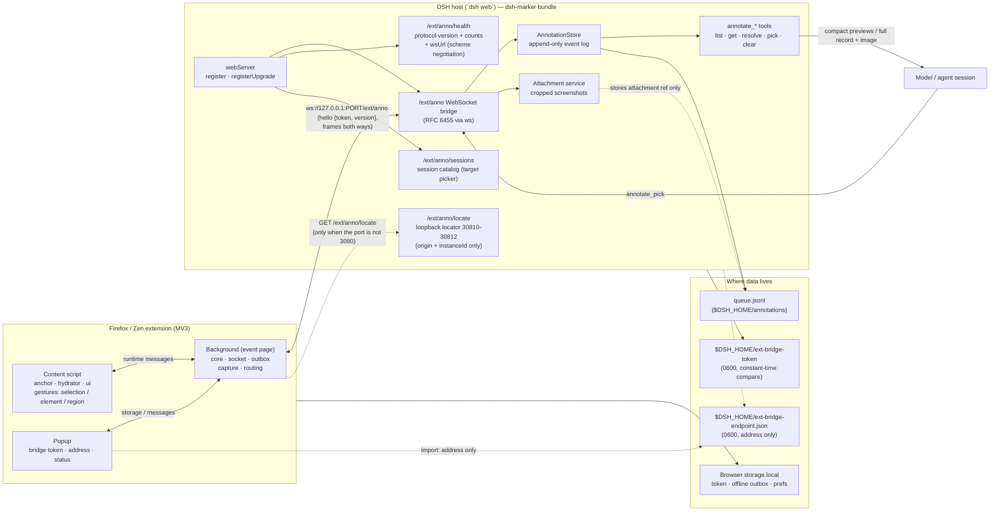

# dsh-marker

[](https://github.com/modenicheng/dsh-annotate/actions/workflows/ci.yml)
[](LICENSE)

[English](README.md) · [简体中文](README.zh-CN.md)

Visual annotations from your everyday browser, as first-class context for
[DeepSeek Harness](https://github.com/deepseek-ai/deepseek-harness) (DSH).

Point at a paragraph, a button, or a region of a page in Firefox, Zen, or a
Chromium browser, write one line of intent, and the annotation lands in the
running DSH session with a cropped screenshot, DOM selectors, and page context.
The model can also ask you to point at something (`annotate_pick`) when a
request is ambiguous.

> **Status: early development.** The protocol, the host plugin, and the
> extension are implemented and covered by tests. The host half and the
> mention-to-chip delivery are verified against a live `dsh web` instance;
> Firefox capture and delivery are verified in a real browser, while Zen, the
> discovery flow, and the Desktop run still need theirs. The acceptance
> criteria per milestone are in [docs/PLAN.md](docs/PLAN.md).

## Install

Requirements: Node.js 22+ and DSH 0.2 or newer with the Web profile. The
extension runs in Firefox 128+ or Zen; the Chromium build (Chrome, Edge,
Brave, …) is installed manually from a release, as below.

### Host plugin

The host plugin is an ordinary DSH bundle, published as `dsh-marker`:

```sh
# install into the profile you boot (add --profile <name> for another one)
dsh plugin add dsh-marker
```

`plugin add` pulls the bundle from the npm registry together with its one
runtime dependency (`ws`), so the machine needs the registry reachable once.
Then boot the host as usual — on the profile you installed into — and it
writes the bridge token the extension will ask for
(`$DSH_HOME/ext-bridge-token`, created on first use).

If the bundle is installed but not active, open **Plugins** in the DSH Web UI
and enable `dsh-marker`. The same page can install a local bundle directly
(**Add plugin**), which is the easier route if you prefer the GUI.

### Extension

> **Not in a store yet.** The first AMO and Chrome Web Store listings are not
> live, so pick a manual route below.

#### From a GitHub release — no store, no checkout

Every published release carries both extension packages, built and checksummed
by CI; nothing is built on your machine.

1. Download the package for your browser from
   [Releases](https://github.com/modenicheng/dsh-annotate/releases) —
   `dsh-marker-firefox-<version>.zip` or `dsh-marker-chromium-<version>.zip` —
   together with `checksums.txt`, verify it, and unzip it:
   `sha256sum -c checksums.txt --ignore-missing` (macOS: `shasum -a 256 -c …`;
   Windows: `certutil -hashfile <file> SHA256`).
2. **Chromium** (Chrome, Edge, Brave, Vivaldi, Opera, Arc): open
   `chrome://extensions`, enable **Developer mode**, choose **Load unpacked**,
   and select the unzipped folder. The extension stays installed across
   restarts. Two costs: the browser shows a developer-mode notice, and updates
   are manual — download the next release and replace the folder.
3. **Firefox / Zen**: release Firefox installs add-ons signed by AMO only. The
   release zip is unsigned, so load it as a temporary add-on —
   `about:debugging#/runtime/this-firefox` (Zen: `about:debugging`), **Load
   Temporary Add-on…**, the unzipped `manifest.json` — and reload it after each
   browser restart. When a release carries a signed `.xpi` (CI attaches one as
   soon as AMO signing is configured), it installs permanently via
   `about:addons` → gear menu → **Install Add-on From File…**. On Firefox
   Developer Edition, Nightly, or ESR you can instead set
   `xpinstall.signatures.required` to `false` in `about:config` and install
   the zip permanently by renaming it to `.xpi` first.

#### From source — for development

The source needs no build step — `packages/extension` is the extension, with no
bundler, no TypeScript and no dependency. Load `packages/extension/manifest.json`
as a temporary add-on (`about:debugging#/runtime/this-firefox`; Zen:
`about:debugging`).

Firefox is what has been run for real; Chromium has had its browser QA pass in
Chromium 156 — load, service worker, content script, popup, and the annotation
HUD.

What the extension reads, where it sends it and what it keeps locally is
[docs/privacy.md](docs/privacy.md) — the same page the stores link to.

### First annotation

1. Open the extension popup and paste the bridge token from
   `$DSH_HOME/ext-bridge-token` (`%USERPROFILE%\.dsh\ext-bridge-token` on
   Windows). Leave **Connection** on *Automatic* and the address at the default
   `127.0.0.1` / `3080`; the extension then finds a host whose port moved by
   itself.
2. Press `Alt+Shift+A` on a page: select text, click an element, or drag a
   region, then press Enter. The comment is optional — with an empty one the
   mark is sent on its own (the button reads **Send mark** / **只发标记**).
3. If the host cannot be found: switch to *Manual* and type the address — a
   full URL such as `wss://anno.example.com` works, and with no scheme the
   extension asks the host which one to use — or use **Import endpoint file…**
   to read the address from `$DSH_HOME/ext-bridge-endpoint.json`. Details:
   [docs/DISCOVERY.md](docs/DISCOVERY.md).

## Tools

The host registers five tools, which appear in your DSH sessions; the one you
will see most is `annotate_pick`, the banner asking you to point at something.
All of them operate on the annotation store and broadcast changes back to
connected browsers.

| Tool | What it does |
|---|---|
| `annotate_list` | List annotations, default `open`, with `status`, `url_filter`, `kind`, and `limit` filters. Returns compact previews. |
| `annotate_get` | Read one annotation by `id` (or `latest`): full anchor JSON plus the cropped screenshot as an image block. |
| `annotate_resolve` | Mark an annotation `resolved` or `wont_fix` with a note the page badge shows, and optionally record `files_touched`. |
| `annotate_pick` | Ask the user to point at something in the browser; the call waits (5 s–15 min, default 2 min) for a selection, element, or region. |
| `annotate_clear` | Bulk-delete annotations by `status` and/or `before_iso`. |

## Security model

The bridge is local-only by design:

- **No public port by default.** It attaches to the DSH host webserver, which
  binds to loopback (`127.0.0.1`) by default. Putting that webserver behind a
  tunnel or reverse proxy makes the websocket reachable wherever that server is,
  so terminate TLS in front of it, do not log frames, and keep the port off
  `0.0.0.0`.
- **Token handshake.** The first frame must be `hello { token, version }`. The
  token is 32 random bytes as hex, stored in `$DSH_HOME/ext-bridge-token` with
  owner-only permissions on POSIX, and compared in constant time. A client that
  does not authenticate within 5 seconds is disconnected, and the protocol
  version must match exactly.
- **No token, no data.** Without a valid token the host closes the socket; the
  only anonymous endpoint is `/ext/anno/health`, which reports the protocol
  version, counts, and the scheme/URL a browser should use — never annotation
  content.
- **Discovery publishes an address, not a secret.** The loopback locator answers
  one `GET` with the host's origin and a per-process id; it returns no token and
  no annotation data, and refuses a `Host` that is not loopback.
- **Bounded input.** Frames are capped at 32 MiB, records are validated against
  `packages/protocol/src/index.js`, and the store only keeps references to
  screenshots that DSH's own attachment service accepts.
- **Local storage.** Annotations live under `$DSH_HOME`; nothing leaves the
  machine and there is no telemetry.

The practical trust boundary: anyone who can read `$DSH_HOME/ext-bridge-token`
or write to your profile directory can already act as you locally.

## Where data lives

| Location | Contents |
|---|---|
| `$DSH_HOME/annotations/queue.jsonl` | Append-only event log (`put`, `patch`, `del`, `img`), folded in memory at startup and compacted when it grows stale. |
| DSH attachment service | Cropped screenshots; the log stores only the attachment reference. |
| `$DSH_HOME/ext-bridge-token` | Bridge token, generated on first use with mode `0600`. |
| `$DSH_HOME/ext-bridge-endpoint.json` | The listening origin, `instanceId`, profile label, and timestamps — address only, no token, written atomically on every start. |
| Browser `storage.local` | Extension token, offline outbox, UI preferences, and the endpoint the host advertised last. Details: [docs/privacy.md](docs/privacy.md#what-is-stored-in-the-browser). |

`$DSH_HOME` defaults to `~/.dsh` (`%USERPROFILE%\.dsh` on Windows). It is shared
by every profile on the machine, so one token works for whichever profile is
running — only one profile should run the bridge at a time.

## Architecture



There is no extra daemon, and on the default deployment no extra port. The
bridge is mounted on the DSH host webserver and lives exactly as long as
`dsh web` does. A host whose port is not `3080` also opens one small loopback
*locator* so a browser can find it; it answers a single address lookup and
carries no annotation data. Both sides are plain ESM JavaScript with no build
step.

Non-default deployments — Desktop's moving port, TLS, reverse proxies — are
covered in [docs/DEPLOYMENT.md](docs/DEPLOYMENT.md); the discovery design and
rationale are in [docs/DISCOVERY.md](docs/DISCOVERY.md).

## Development

An isolated `anno` profile keeps the daily `web` profile untouched, and installs
the bundle from this checkout instead of the registry:

```sh
# 1. Create the isolated profile from the shipped Web template (once).
#    This initialises the profile before booting it; Ctrl+C if port 3080 is busy.
dsh --profile anno --from-default-profile web

# 2. Install the bundle from this checkout (a local directory, no registry).
dsh plugin --profile anno add /absolute/path/to/dsh-annotate/packages/plugin

# 3. Boot the profile and open the Web UI it prints.
dsh --profile anno
```

On Windows use the same commands in PowerShell, with a Windows path such as
`D:\coding\dsh-annotate\packages\plugin`.

```sh
pnpm run sync-protocol                              # copy the protocol into both consumers
node --test "packages/*/test/*.test.js"             # works in PowerShell and cmd
pnpm run check                                      # Biome + sync + syntax + tests
node scripts/smoke-ws.mjs ws://127.0.0.1:3080/ext/anno   # verify a booted bridge, no browser needed
node scripts/smoke-discovery.mjs                    # verify the record + locator of a --port 0 host
```

`smoke-ws.mjs` drives the real socket end to end (health probe, token
handshake, create → query → resolve, idempotent replay); run it after installing
the bundle and after any protocol change. `smoke-discovery.mjs` is its discovery
counterpart against a `dsh --profile anno --port 0` host. The quoted glob is
intentional: Node expands it itself, which keeps the command identical on
Windows, macOS, and Linux. `pnpm run check` fetches the pinned Biome version
through `npx`, so it needs network access the first time; the tests and hooks do
not.

The two store targets are generated from one source tree for local QA and
inspection — `node scripts/build-extension.mjs` writes `dist/firefox` and
`dist/chromium`. A local build is for testing only: the packages a store
receives are built by CI from the release tag
([docs/DISTRIBUTION.md](docs/DISTRIBUTION.md) §4.4), and a manual install above
downloads those same CI bytes — never a local build.

Local hooks enforce Conventional Commits and run the checks before each
commit; [CONTRIBUTING.md](CONTRIBUTING.md) has the one-line setup and the
rules.

## Status and roadmap

| Phase | Scope | State |
|---|---|---|
| M0 | Protocol, repository base, CI, hooks | done |
| M1 | Host plugin, storage loop, tools | implemented, verified against a live host |
| M2 | Extension capture: gestures, overlay, crop, outbox | implemented; browser QA pending |
| M3 / M3.5–M3.8 | Re-anchoring, picks, `dsh-anno:` mentions, chip hover card, push delivery | implemented; browser-side pieces pending live verification |
| M4 | Developer context, session routing, multi-window | planned |
| M4.5 | Discovery: Desktop's moving port, endpoint record, loopback locator | delivered; real-browser and Desktop runs pending (M4.5c) |
| M4.6 | Send an annotation into a new session (default / existing / new workspace) | implemented; browser QA pending |
| M5 | Signing and distribution | planned |

The detailed deliverables and acceptance criteria are in
[docs/PLAN.md](docs/PLAN.md); implementation decisions and their rationale are
in [docs/DECISIONS.md](docs/DECISIONS.md).

## Documentation

Using dsh-marker:

- [docs/INTERACTION.md](docs/INTERACTION.md) — interaction and capture UX
- [docs/privacy.md](docs/privacy.md) — data handling and privacy
- [docs/DEPLOYMENT.md](docs/DEPLOYMENT.md) — TLS, reverse proxies, Desktop's moving port

Design and internals:

- [docs/DISCOVERY.md](docs/DISCOVERY.md) — discovery design and rationale
- [docs/PLAN.md](docs/PLAN.md) / [docs/DECISIONS.md](docs/DECISIONS.md) — roadmap, decisions

For contributors:

- [CONTRIBUTING.md](CONTRIBUTING.md) — commit format, hooks, generated-file rule
- [docs/DISTRIBUTION.md](docs/DISTRIBUTION.md) / [docs/STORE_LISTING.md](docs/STORE_LISTING.md) — store packaging and listing

## License

MIT — see [LICENSE](LICENSE).
