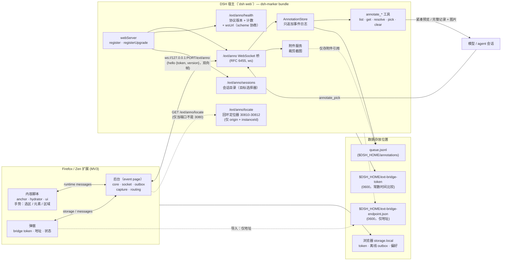

# dsh-marker

[](https://github.com/modenicheng/dsh-annotate/actions/workflows/ci.yml)
[](LICENSE)

[English](README.md) · [简体中文](README.zh-CN.md)

把日常浏览器里的可视化标注，作为一等上下文交给
[DeepSeek Harness](https://github.com/deepseek-ai/deepseek-harness)（DSH）。

在 Firefox 或 Zen 里指向一个段落、一个按钮或页面上的一块区域，写一句意图，
标注就会带着裁剪截图、DOM 选择器和页面上下文进入正在运行的 DSH 会话。当请求有歧义时，
模型也可以反过来请你指一下页面上的东西（`annotate_pick`）。

> **状态：早期开发。** 协议、宿主插件和扩展均已实现并有测试覆盖。宿主侧和
> mention 到 chip 的投递已在真实 `dsh web` 实例上验证；浏览器侧的捕获手势和发现流程
> 还需要在真实浏览器里过一遍。哪些已验证、哪些没有，见
> [docs/PLAN.md](docs/PLAN.md)。

## 架构



没有额外的守护进程，默认部署下也没有额外端口。桥挂在 DSH 宿主的 webserver 上，
与 `dsh web` 同生共死。端口不是 `3080` 的宿主会额外开一个很小的回环*定位器*，
让浏览器能找到它；它只回答一次地址查询，不携带任何标注数据。两侧都是纯 ESM
JavaScript，无需构建。

非默认部署——Desktop 的移动端口、TLS、反向代理——见
[docs/DEPLOYMENT.md](docs/DEPLOYMENT.md)；发现机制的设计与理由见
[docs/DISCOVERY.md](docs/DISCOVERY.md)（英文）。

## 安装

要求：Node.js 22+，装有 Web profile 的 DSH；扩展需要 Firefox 128+ 或 Zen。

### 宿主插件

宿主插件是一个普通的 DSH bundle，发布为 `dsh-marker`：

```sh
# 安装到你启动的 profile（其他 profile 加 --profile <name>）
dsh plugin add dsh-marker
```

`plugin add` 会从 npm registry 拉取 bundle 及其唯一的运行时依赖（`ws`），
因此首次安装需要能访问 registry。

开发时使用隔离的 `anno` profile，不动日常的 `web` profile，并从本仓库安装：

```sh
# 1. 用自带的 Web 模板创建隔离 profile（一次性）。
#    它会先初始化再启动 profile；若 3080 端口被占用则 Ctrl+C。
dsh --profile anno --from-default-profile web

# 2. 从本仓库安装 bundle（本地目录，不经 registry）。
dsh plugin --profile anno add /absolute/path/to/dsh-annotate/packages/plugin

# 3. 启动 profile，打开它打印的 Web UI 地址。
dsh --profile anno
```

Windows 下在 PowerShell 里使用同样命令，路径写 Windows 形式，例如
`D:\coding\dsh-annotate\packages\plugin`。

若 bundle 已安装但未启用，在 DSH Web UI 的 **Plugins** 页启用 `dsh-marker`。
同一页面也可以直接安装本地 bundle（**Add plugin**），偏好图形界面的话更省事。

### 扩展

> 尚未上架：AMO 和 Chrome Web Store 的首个条目还没上线，请从本仓库安装。
> 商店文案见 [docs/STORE_LISTING.md](docs/STORE_LISTING.md)（英文）。

源码无需构建——`packages/extension` 就是扩展本体，没有 bundler、没有
TypeScript、没有依赖。以临时附加组件方式加载：

1. 打开 `about:debugging#/runtime/this-firefox`（Zen 为 `about:debugging`）。
2. 选择 **Load Temporary Add-on…**，选中
   `packages/extension/manifest.json`。
3. 打开扩展弹窗，粘贴 `$DSH_HOME/ext-bridge-token`
   （Windows 为 `%USERPROFILE%\.dsh\ext-bridge-token`）里的桥接 token。
   **Connection** 保持 *Automatic*、地址保持默认 `127.0.0.1` / `3080`，
   扩展会自己找到端口变了的宿主。切到 *Manual* 可以手输地址；两种模式下都支持
   完整 URL（如 `wss://anno.example.com`），不写 scheme 时扩展会询问宿主。
   若自动发现找不到宿主，用 **Import endpoint file…** 从
   `$DSH_HOME/ext-bridge-endpoint.json` 读入地址
   （见 [docs/DISCOVERY.md](docs/DISCOVERY.md)）。
4. 在页面上按 `Alt+Shift+A` 进入标注模式：选择文字、点击元素或框选区域，
   然后按 Enter。备注可选——留空时只发送标记（按钮显示
   **Send mark** / **只发标记**）。

临时附加组件在浏览器关闭后消失。要让安装永久化需要 addons.mozilla.org
签名的 `.xpi`（M5）。

两个目标由同一份源码生成，供本地 QA 和检查：

```sh
node scripts/build-extension.mjs        # dist/firefox + dist/chromium
```

本地构建只用于测试；商店收到的包由 CI 从发布 tag 构建
（[docs/DISTRIBUTION.md](docs/DISTRIBUTION.md) §4.4）。

Firefox 是真正跑过的平台；Chromium 已在 Chromium 156 里通过浏览器 QA ——
加载、service worker、content script、popup 和批注 HUD。

扩展读了什么、发到哪里、本地留了什么，见
[docs/privacy.md](docs/privacy.md)——商店链接的也是这一页。

## 工具

宿主注册了五个工具，全部作用于标注库，并把变更广播回已连接的浏览器。

| 工具 | 作用 |
|---|---|
| `annotate_list` | 列出标注，默认 `open`，支持 `status`、`url_filter`、`kind`、`limit` 过滤。返回紧凑预览。 |
| `annotate_get` | 按 `id`（或 `latest`）读取一条标注：完整 anchor JSON，外加裁剪截图的图片块。 |
| `annotate_resolve` | 将标注标记为 `resolved` 或 `wont_fix`，附一条页面徽标会显示的备注，可选记录 `files_touched`。 |
| `annotate_pick` | 请用户在浏览器里指一下某物；调用会等待（5 秒–15 分钟，默认 2 分钟）一次选区、元素或区域标注。 |
| `annotate_clear` | 按 `status` 和/或 `before_iso` 批量删除标注。 |

## 安全模型

桥在设计上只服务本机：

- **默认不开公共端口。** 桥挂在 DSH 宿主 webserver 上，后者默认只绑定回环地址
  （`127.0.0.1`）。若把该 webserver 放到隧道或反向代理后面，websocket 就随该
  服务器一起可达——请在其前面终结 TLS、不要记录帧日志、不要监听 `0.0.0.0`。
- **token 握手。** 第一帧必须是 `hello { token, version }`。token 为 32 字节
  随机数的十六进制，存于 `$DSH_HOME/ext-bridge-token`（POSIX 上仅属主可读），
  比较用常数时间。5 秒内未通过认证的客户端会被断开，协议版本必须精确匹配。
- **无 token，无数据。** 没有有效 token 时宿主直接关闭 socket；唯一的匿名端点是
  `/ext/anno/health`，只报告协议版本、计数和浏览器应使用的 scheme/URL——
  永远不含标注内容。
- **发现只发布地址，不发布秘密。** 回环定位器只以一次 `GET` 回答宿主 origin 和
  进程级 id；不返回 token 和标注数据，且拒绝非回环的 `Host`。
- **输入有界。** 帧上限 32 MiB，记录按 `packages/protocol/src/index.js` 校验，
  库里只保存 DSH 自身附件服务接受的截图引用。
- **本地存储。** 标注都在 `$DSH_HOME` 之下；不出本机，无遥测。

实际的信任边界是：能读 `$DSH_HOME/ext-bridge-token` 或能写你 profile 目录的人，
本来就能在本机上冒充你。

## 数据存放位置

| 位置 | 内容 |
|---|---|
| `$DSH_HOME/annotations/queue.jsonl` | 只追加事件日志（`put`、`patch`、`del`、`img`），启动时在内存中折叠，过期后压缩。 |
| DSH 附件服务 | 裁剪截图；日志只保存附件引用。 |
| `$DSH_HOME/ext-bridge-token` | 桥接 token，首次使用时以 `0600` 权限生成。 |
| `$DSH_HOME/ext-bridge-endpoint.json` | 监听 origin、`instanceId`、profile 标签和时间戳——仅地址，无 token，每次启动原子写入。 |
| 浏览器 `storage.local` | 扩展 token、离线 outbox、UI 偏好，以及宿主最近通告的端点。详见 [docs/privacy.md](docs/privacy.md#what-is-stored-in-the-browser)。 |

`$DSH_HOME` 默认为 `~/.dsh`（Windows 为 `%USERPROFILE%\.dsh`），为机器上所有
profile 共享，因此一个 token 对任何正在运行的 profile 都有效——但同一时刻只应有
一个 profile 运行桥。

## 开发

```sh
pnpm run sync-protocol                              # 把协议拷贝进两个消费方
node --test "packages/*/test/*.test.js"             # PowerShell 和 cmd 下均可
pnpm run check                                      # Biome + sync + 语法 + 测试
node scripts/smoke-ws.mjs ws://127.0.0.1:3080/ext/anno   # 验证已启动的桥，无需浏览器
node scripts/smoke-discovery.mjs                    # 验证 --port 0 宿主的记录 + 定位器
```

`smoke-ws.mjs` 端到端驱动真实 socket（health 探测、token 握手、
创建 → 查询 → resolve、幂等重放）；装好 bundle 后和每次协议改动后都应运行。
`smoke-discovery.mjs` 是它面向发现的对应物，针对
`dsh --profile anno --port 0` 启动的宿主。带引号的 glob 是有意的：由 Node
自行展开，使命令在 Windows、macOS 和 Linux 上完全一致。`pnpm run check` 通过
`npx` 拉取固定版本的 Biome，首次需要联网；测试和钩子不需要。

本地钩子强制 Conventional Commits 并在每次提交前运行检查：

```sh
git config core.hooksPath .githooks
```

提交格式、钩子细节和生成文件规则见
[CONTRIBUTING.md](CONTRIBUTING.md)（英文）。

## 状态与路线图

| 阶段 | 范围 | 状态 |
|---|---|---|
| M0 | 协议、仓库基础、CI、钩子 | 完成 |
| M1 | 宿主插件、存储环、工具 | 已实现，真实宿主上验证过 |
| M2 | 扩展捕获：手势、覆盖层、裁剪、outbox | 已实现；浏览器 QA 待做 |
| M3 / M3.5–M3.8 | 重锚定、pick、`dsh-anno:` mention、chip 悬浮卡、推送投递 | 已实现；浏览器侧待真机验证 |
| M4 | 开发者上下文、会话路由、多窗口 | 计划中 |
| M4.5 | 发现：Desktop 移动端口、端点记录、回环定位器 | 已交付；真机浏览器与 Desktop 运行待做（M4.5c） |
| M4.6 | 批注发送到新建会话（默认 / 已有 / 新建工作区） | 已实现；浏览器 QA 待做 |
| M5 | 签名与分发 | 计划中 |

详细交付物和验收标准见 [docs/PLAN.md](docs/PLAN.md)（英文）；实现决策及理由见
[docs/DECISIONS.md](docs/DECISIONS.md)（英文）。

## 文档

- [docs/DEPLOYMENT.md](docs/DEPLOYMENT.md) — TLS、反向代理、Desktop 移动端口（英文）
- [docs/DISCOVERY.md](docs/DISCOVERY.md) — 发现机制设计与理由（英文）
- [docs/INTERACTION.md](docs/INTERACTION.md) — 交互与捕获 UX（英文）
- [docs/privacy.md](docs/privacy.md) — 数据处理与隐私（英文）
- [docs/PLAN.md](docs/PLAN.md) / [docs/DECISIONS.md](docs/DECISIONS.md) — 路线图与决策（英文）
- [docs/DISTRIBUTION.md](docs/DISTRIBUTION.md) / [docs/STORE_LISTING.md](docs/STORE_LISTING.md) — 商店打包与文案（英文）
- [CONTRIBUTING.md](CONTRIBUTING.md) — 提交格式、钩子、生成文件规则（英文）

## 许可证

MIT——见 [LICENSE](LICENSE)。
