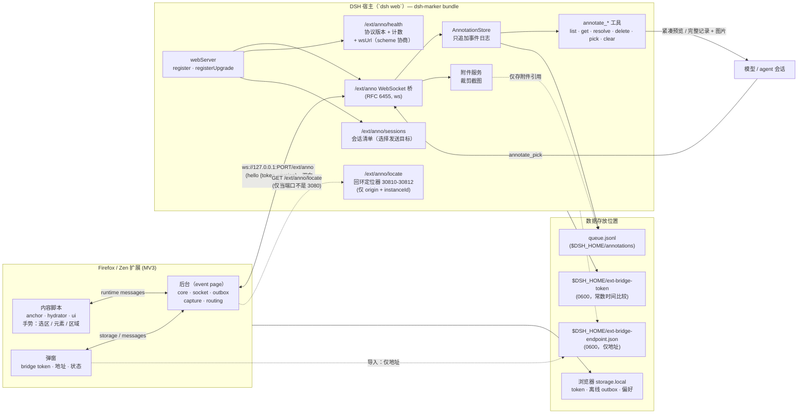

# dsh-marker

[](https://github.com/modenicheng/dsh-annotate/actions/workflows/ci.yml)
[](LICENSE)

[English](README.md) · [简体中文](README.zh-CN.md)

把你在浏览器里做的标注，作为直接上下文交给
[DeepSeek Harness](https://github.com/deepseek-ai/deepseek-harness)（DSH）。

在 Firefox、Zen 或 Chromium 浏览器里指向一个段落、一个按钮或页面上的一块
区域，写一句你想做什么，标注就会带着裁剪截图、DOM 选择器和页面上下文进入
正在运行的 DSH 会话。当请求有歧义时，模型也可以反过来请你指一下页面上的
东西（`annotate_pick`）。

> **状态：早期开发。** 协议、宿主插件和扩展均已实现并有测试覆盖。宿主侧和
> mention 到 chip 悬浮卡的投递已在真实 `dsh web` 实例上验证；Firefox 的捕获
> 与投递已在真实浏览器里验证，Zen、发现流程和 Desktop 还没有。各阶段的验收
> 标准见 [docs/PLAN.md](docs/PLAN.md)（英文）。

## 安装

要求：Node.js 22+，DSH 0.2 及以上且带 Web profile；扩展需要 Firefox
128+ 或 Zen；Chromium 版（Chrome、Edge、Brave 等）从 Release 手动安装，
见下文。

### 宿主插件

宿主插件是一个普通的 DSH bundle，发布为 `dsh-marker`：

```sh
# 安装到你启动的 profile（其他 profile 加 --profile <name>）
dsh plugin add dsh-marker
```

`plugin add` 会从 npm registry 拉取 bundle 及其唯一的运行时依赖（`ws`），
因此首次安装时机器要能访问 registry。然后在安装它的 profile 上照常启动宿
主；首次使用时会写出扩展所需的桥接 token
（`$DSH_HOME/ext-bridge-token`）。

若 bundle 已安装但未启用，在 DSH Web UI 的 **Plugins** 页启用
`dsh-marker`。同一页面也可以直接安装本地 bundle（**Add plugin**），偏好
图形界面的话更省事。

### 扩展

> **尚未上架。** AMO（addons.mozilla.org）与 Chrome Web Store 的首次上架
> 还没上线，请先从下面的手动途径安装。

#### 从 GitHub Release 安装——无需商店、无需检出源码

每个已发布的 Release 都带有两个扩展包，由 CI 构建并附带校验和；你不需要
在本机构建任何东西。

1. 从 [Releases](https://github.com/modenicheng/dsh-annotate/releases) 下载
   对应浏览器的包——`dsh-marker-firefox-<版本>.zip` 或
   `dsh-marker-chromium-<版本>.zip`——连同 `checksums.txt`，校验后解压：
   `sha256sum -c checksums.txt --ignore-missing`（macOS：`shasum -a 256
   -c …`；Windows：`certutil -hashfile <文件> SHA256`）。
2. **Chromium**（Chrome、Edge、Brave、Vivaldi、Opera、Arc）：打开
   `chrome://extensions`，开启**开发者模式**，选择**加载已解压的扩展程序**
   （Load unpacked），选中解压后的文件夹。扩展会跨浏览器重启保留。代价有
   二：浏览器会显示开发者模式提示；更新是手动的——下载下一个 Release，
   替换文件夹即可。
3. **Firefox / Zen**：正式版 Firefox 只安装 AMO 签名的附加组件。Release
   里的 zip 未签名，因此要作为临时附加组件加载——
   `about:debugging#/runtime/this-firefox`（Zen 为 `about:debugging`）→
   **Load Temporary Add-on…** → 选中解压出的 `manifest.json`——且每次
   重启浏览器后需要重新加载。当某个 Release 带有签名 `.xpi`（AMO 签名一
   接入 CI 就会有）时，可通过 `about:addons` → 齿轮菜单 → **Install
   Add-on From File…** 永久安装。Firefox Developer Edition、Nightly 或
   ESR 用户也可以在 `about:config` 里把 `xpinstall.signatures.required`
   设为 `false`，然后把 zip 改名为 `.xpi` 永久安装。

#### 从源码安装——面向开发

源码无需构建——`packages/extension` 就是扩展本体，没有 bundler、没有
TypeScript、没有依赖。把 `packages/extension/manifest.json` 作为临时附加
组件加载即可（`about:debugging#/runtime/this-firefox`；Zen 为
`about:debugging`）。

Firefox 是真正跑过的平台。早期版本曾在 Chromium 156 里通过一轮基础
bring-up 验证——加载、service worker、content script、弹窗（popup）和
标注 HUD，表现与 Firefox 基本一致——但最新版本未再做过 Chromium 实机
验证。

扩展读了什么、发到哪里、本地留了什么，见
[docs/privacy.md](docs/privacy.md)——商店链接的也是这一页。

### 第一条标注

1. 打开扩展弹窗，粘贴 `$DSH_HOME/ext-bridge-token`（Windows 为
   `%USERPROFILE%\.dsh\ext-bridge-token`）里的桥接 token。**Connection**
   保持 *Automatic*、地址保持默认 `127.0.0.1` / `3080`；即使宿主端口变
   了，扩展也会自己找到。
2. 在页面上按 `Alt+Shift+A`：选择文字、点击元素或框选区域，然后按
   Enter。悬停元素时 `Tab` 逐层扩大到父元素、`Shift+Tab` 逐层收回，点击
   锁定当前层。备注可选——留空时只发送标记本身（按钮显示 **Send mark** /
   **只发标记**）。
3. 如果找不到宿主：切到 *Manual* 手输地址——完整 URL（如
   `wss://anno.example.com`）两种模式都支持，不写 scheme 时扩展会询问宿
   主——或用 **Import endpoint file…** 从
   `$DSH_HOME/ext-bridge-endpoint.json` 读入地址。细节见
   [docs/DISCOVERY.md](docs/DISCOVERY.md)（英文）。

## 工具

宿主注册了六个工具，会出现在你的 DSH 会话里；你最常见到的是
`annotate_pick`——请你指一下页面的横幅。它们全部作用于标注库，并把变更广播
回已连接的浏览器。

| 工具 | 作用 |
|---|---|
| `annotate_list` | 列出标注，默认 `open`，支持 `status`、`url_filter`、`kind`、`limit` 过滤。返回紧凑预览。 |
| `annotate_get` | 按 `id`（或 `latest`）读取一条标注：完整 anchor JSON，外加裁剪截图的图片块。 |
| `annotate_resolve` | 将标注标记为 `resolved` 或 `wont_fix`，附一条备注显示在页面角标上，可选记录 `files_touched`。 |
| `annotate_delete` | 按 `ids` 直接删除标注：记录、裁剪图与页面角标一并消失。用于清理本就不该留下的东西（测试标记、过期截屏）；工作确已做完时仍优先 `annotate_resolve`。 |
| `annotate_pick` | 请用户在浏览器里指一下某物；调用会等待（5 秒–15 分钟，默认 2 分钟）用户做出一次选区、元素或区域标注。 |
| `annotate_clear` | 按 `status`、`before_iso` 单独或组合批量删除标注。 |

## 安全模型

桥在设计上只服务本机：

- **默认不开公共端口。** 桥挂在 DSH 宿主 webserver 上，后者默认只绑定回环
  地址（`127.0.0.1`）。若把该 webserver 放到隧道或反向代理后面，websocket
  就随该服务器一起可达——请在其前面终结 TLS、不要记录帧日志、不要监听
  `0.0.0.0`。
- **token 握手。** 第一帧必须是 `hello { token, version }`。token 为 32 字节
  随机数的十六进制，存于 `$DSH_HOME/ext-bridge-token`（POSIX 上仅属主可
  读），比较在常数时间内完成。宿主会断开 5 秒内未通过认证的客户端，协议
  版本必须精确匹配。
- **无 token，无数据。** 没有有效 token 时宿主直接关闭 socket；唯一的匿名
  端点是 `/ext/anno/health`，只报告协议版本、各项计数和浏览器应使用的
  scheme/URL——永不含标注内容。
- **发现只发布地址，不发布机密。** 回环定位器只响应一次 GET，返回宿主
  origin 和进程 id；不返回 token 和标注数据，且拒绝非回环的 `Host`。
- **输入有界。** 帧上限 32 MiB，记录按 `packages/protocol/src/index.js`
  校验，库里只保存 DSH 自身附件服务接受的截图引用。
- **本地存储。** 标注都在 `$DSH_HOME` 之下；不出本机，无遥测。

实际的信任边界是：能读 `$DSH_HOME/ext-bridge-token` 或能写你 profile 目录
的人，本来就能在本机上冒充你。

## 数据存放位置

| 位置 | 内容 |
|---|---|
| `$DSH_HOME/annotations/queue.jsonl` | 只追加事件日志（`put`、`patch`、`del`、`img`），启动时在内存中重放合并，变得冗余后压缩。 |
| DSH 附件服务 | 裁剪截图；日志只保存附件引用。 |
| `$DSH_HOME/ext-bridge-token` | 桥接 token，首次使用时以 `0600` 权限生成。 |
| `$DSH_HOME/ext-bridge-endpoint.json` | 监听 origin、`instanceId`、profile 标签和时间戳——仅地址，无 token，每次启动原子写入。 |
| 浏览器 `storage.local` | 扩展 token、离线 outbox、UI 偏好，以及宿主最近通告的端点。详见 [docs/privacy.md](docs/privacy.md#what-is-stored-in-the-browser)。 |

`$DSH_HOME` 默认为 `~/.dsh`（Windows 为 `%USERPROFILE%\.dsh`），为机器上
所有 profile 共享，因此一个 token 对任何正在运行的 profile 都有效——但同
一时刻只应有一个 profile 运行桥。

## 架构



没有额外的守护进程，默认部署下也没有额外端口。桥挂在 DSH 宿主的
webserver 上，与 `dsh web` 同生共死。端口不是 `3080` 的宿主会额外开一个
很小的回环*定位器*，让浏览器能找到它；它只回答一次地址查询，不携带任何
标注数据。两侧都是纯 ESM JavaScript，无需构建。

非默认部署——Desktop 的动态端口、TLS、反向代理——见
[docs/DEPLOYMENT.md](docs/DEPLOYMENT.md)（英文）；发现机制的设计与理由见
[docs/DISCOVERY.md](docs/DISCOVERY.md)（英文）。

## 开发

开发时使用隔离的 `anno` profile，不动日常的 `web` profile，并从本仓库
安装：

```sh
# 1. 用自带的 Web 模板创建隔离 profile（一次性）。
#    它会先初始化再启动 profile；若 3080 端口被占用则 Ctrl+C。
dsh --profile anno --from-default-profile web

# 2. 从本仓库安装 bundle（本地目录，不经 registry）。
dsh plugin --profile anno add /absolute/path/to/dsh-annotate/packages/plugin

# 3. 启动 profile，按它输出的地址打开 Web UI。
dsh --profile anno
```

Windows 下在 PowerShell 里使用同样命令，路径写 Windows 形式，例如
`D:\coding\dsh-annotate\packages\plugin`。

```sh
pnpm run sync-protocol                              # 把协议复制进两个使用方
node --test "packages/*/test/*.test.js"             # PowerShell 和 cmd 下均可
pnpm run check                                      # Biome + sync + 语法 + 测试
node scripts/smoke-ws.mjs ws://127.0.0.1:3080/ext/anno   # 验证已启动的桥，无需浏览器
node scripts/smoke-discovery.mjs                    # 验证 --port 0 宿主的记录 + 定位器
```

`smoke-ws.mjs` 端到端驱动真实 socket（health 探测、token 握手、创建 →
查询 → resolve、幂等重放）；装好 bundle 后和每次协议改动后都应运行。
`smoke-discovery.mjs` 作用与之相同，验证的是发现流程，宿主以
`dsh --profile anno --port 0` 启动。带引号的 glob 是有意的：由 Node 自行
展开，使命令在 Windows、macOS 和 Linux 上完全一致。Biome 是固定版本的
devDependency：一次 `pnpm install` 之后，`pnpm run check`、钩子和测试全部
离线可用；只有 `pnpm install` 本身需要访问 registry。

扩展的 `_locales/` 目前只本地化 manifest 元数据（商店里的名称与描述）；
界面文案由 `src/content/ui/strings.js` 内置的双语表提供，不走 `_locales/`。

两个商店目标由同一份源码生成，供本地 QA 和检查——
`node scripts/build-extension.mjs` 输出 `dist/firefox` 和 `dist/chromium`。
本地构建只用于测试：商店收到的包由 CI 从发布 tag 构建
（[docs/DISTRIBUTION.md](docs/DISTRIBUTION.md) §4.4），上面的手动安装下载
的也是这些 CI 字节——绝不是本地构建。

本地钩子强制 Conventional Commits 并在每次提交前运行检查；一行设置命令和
规则细节见 [CONTRIBUTING.md](CONTRIBUTING.md)（英文）。

## 状态与路线图

| 阶段 | 范围 | 状态 |
|---|---|---|
| M0 | 协议、仓库基础、CI、钩子 | 完成 |
| M1 | 宿主插件、存储环、工具 | 已实现，真实宿主上验证过 |
| M2 | 扩展捕获：手势、覆盖层、裁剪、outbox | 已实现；浏览器 QA 待做 |
| M3 / M3.5–M3.8 | 重锚定、pick、`dsh-anno:` mention、chip 悬浮卡、推送投递 | 已实现；浏览器侧待真实浏览器验证 |
| M4 | 开发者上下文、会话路由、多窗口 | 计划中 |
| M4.5 | 发现：Desktop 动态端口、端点记录、回环定位器 | 已交付；真实浏览器与 Desktop 运行待做（M4.5c） |
| M4.6 | 标注发送到新建会话（默认 / 已有 / 新建工作区） | 已实现；浏览器 QA 待做 |
| M5 | 签名与分发 | 计划中 |

详细交付物和验收标准见 [docs/PLAN.md](docs/PLAN.md)（英文）；实现决策及
理由见 [docs/DECISIONS.md](docs/DECISIONS.md)（英文）。

## 文档

使用 dsh-marker：

- [docs/INTERACTION.md](docs/INTERACTION.md) — 交互与捕获 UX（英文）
- [docs/privacy.md](docs/privacy.md) — 数据处理与隐私（英文）
- [docs/DEPLOYMENT.md](docs/DEPLOYMENT.md) — TLS、反向代理、Desktop 动态端口（英文）

设计与内部机制：

- [docs/DISCOVERY.md](docs/DISCOVERY.md) — 发现机制设计与理由（英文）
- [docs/PLAN.md](docs/PLAN.md) / [docs/DECISIONS.md](docs/DECISIONS.md) — 路线图与决策（英文）

面向贡献者：

- [CONTRIBUTING.md](CONTRIBUTING.md) — 提交格式、钩子、生成文件规则（英文）
- [docs/DISTRIBUTION.md](docs/DISTRIBUTION.md) / [docs/STORE_LISTING.md](docs/STORE_LISTING.md) — 商店打包与文案（英文）

## 许可证

MIT——见 [LICENSE](LICENSE)。
