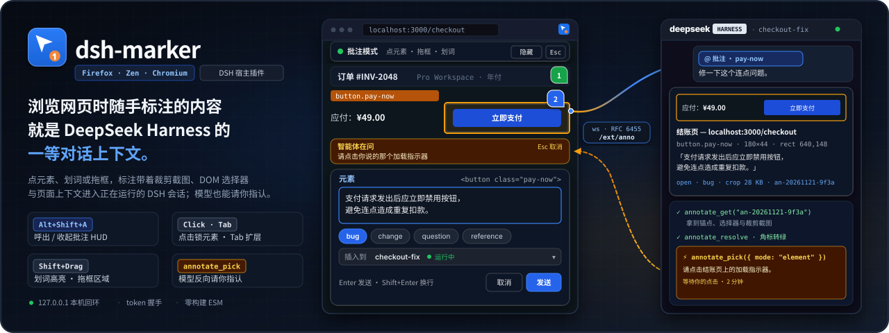
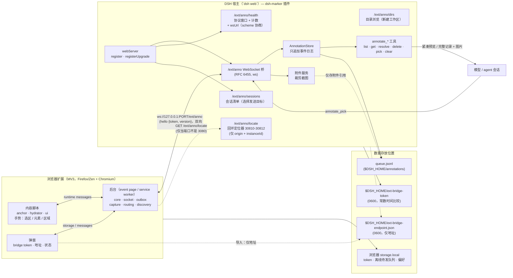

# dsh-marker

[](https://github.com/modenicheng/dsh-annotate/actions/workflows/ci.yml)
[](LICENSE)

[English](README.md) · [简体中文](README.zh-CN.md)

dsh-marker 让你指着网页的一部分，把它连同裁剪截图和页面信息一起交给
[DeepSeek Harness](https://github.com/deepseek-ai/deepseek-harness)（DSH），
作为对话的上下文——而不只是粘贴一个链接，或重复截图并手动粘贴到对话框的过程。

它共有两个部分，DSH和浏览器两边都要装：

1. **DSH 插件**（npm 包 `dsh-marker`）。负责接收和保存标注，并在你的
   DSH 会话里提供 `annotate_*` 工具。一条 `dsh` 命令即可安装。
2. **浏览器扩展**。日常使用的就是这一半：按快捷键，在任意页面上选一段
   文字、点一个元素或框一块区域，想写就写一句备注，然后发送。支持
   Firefox、Zen 和 Chromium 内核浏览器。

中间发生的事：扩展只和同一台机器上的 DSH 实例（`127.0.0.1`）通信；
标注进入 DSH 网页端后，变成你所选会话输入框里的引用块——看得
见、删得掉，在人工发出那条消息之前不会到达模型。也支持当
模型拿不准「你说的是哪个按钮」时，让模型主动调用 `annotate_pick` 请你指认，
页面上会出现一条横幅等你点击。

数据不出本机：没有账号、没有遥测、没有开发者服务器。详见隐私政策文档
[docs/privacy.md](docs/privacy.md)。

> **状态。** 1.0.0 是第一个正式版（2026-11-21）。Edge 商店与 Mozilla
> Add-ons（AMO）条目已上线（安装方式见第 2 步）；Chrome Web Store 的条目
> 已提交、撰写本文时仍在审核，Chrome 等其余 Chromium 浏览器暂时按第 2 步
> 的方法从 GitHub Release 手动安装。捕获与投递已在真实
> Firefox 中验证；Chromium 版只做过早期启动验证，未做端到端复测，
> Zen 与 DSH Desktop 还没有跑过验证。验收标准见
> [docs/PLAN.md](docs/PLAN.md)（英文）。

如果你打算让 AI agent 帮你装，仓库里有一份写给 agent 的操作手册：
[docs/AGENT-INSTALL.md](docs/AGENT-INSTALL.md)（英文）。

## 开始之前需要什么

| 需要 | 为什么 |
|---|---|
| DSH 0.2 及以上，并且运行 Web profile（`dsh web`）或 Desktop 应用 | 插件挂在 DSH 宿主的网页服务器上，扩展连的就是它。 |
| Node.js 22 及以上 | DSH 跑在 Node 上。本产品不在你机器上编译任何东西。 |
| Firefox 128+、Zen，或 Chromium 内核浏览器（Chrome、Edge 88+、Brave、Vivaldi、Opera、Arc） | 装浏览器这一半。 |
| 两个部分装在同一台机器 | 扩展只连 `127.0.0.1`，够不着另一台电脑上的 DSH。 |

文中反复出现两个词，先解释一次：

- **profile**（DSH 的配置环境）：一个 profile 有自己的插件、设置和
  会话目录。`dsh web` 启动名为 `web` 的 profile，也就是网页端。如果你
  用别的 profile，给下面的 `dsh` 命令加上 `--profile <名字>`。
- **`$DSH_HOME`**（DSH 的数据目录）：Linux/macOS 是 `~/.dsh`，
  Windows 是 `%USERPROFILE%\.dsh`。安装过程会用到里面的两个文件。

## 安装

三步：先把插件装进 DSH，再把扩展装进浏览器，最后用一个 token 把两边
连起来。

### 第 1 步 —— 安装 DSH 插件

插件就是一个普通的 DSH 插件包（bundle），发布在 npm 上，名字是
`dsh-marker`：

```sh
dsh plugin add dsh-marker
```

要装进指定 profile，把 `--profile <名字>` 放在 `add` 前面。这条命令
会从 npm 下载插件和它唯一的依赖（`ws`），所以第一次需要机器能访问 npm
registry；DSH 会在安装前检查自己的版本是否满足插件要求。

然后照常启动 DSH——`dsh web`，或 Desktop 应用——用你装了插件的那个
profile。两件事说明装好了：

- 网页端的 **Plugins** 页里出现 `dsh-marker`，且已启用。（如果在列表
  里但未启用，在同一页打开开关即可；这一页的 **Add plugin** 按钮也能
  直接安装，喜欢图形界面可以走这条路。）
- 第一次启动会写出 `$DSH_HOME/ext-bridge-token` 文件——一长串随机
  字符。这就是第 3 步扩展要的 token。

日后的更新：`dsh plugin update dsh-marker`（**Plugins** 页提供同样的
操作）。插件和扩展的版本应大致同步，不同步会发生什么见
[常见问题排查](#常见问题排查)。

### 第 2 步 —— 安装浏览器扩展

从当前 Release 下载对应浏览器的包（由 CI 构建并附校验和，本地不用构建
任何东西）：

| 用途 | 安装包（v1.0.0） |
|---|---|
| Firefox / Zen | [dsh-marker-firefox-1.0.0.zip](https://github.com/modenicheng/dsh-annotate/releases/download/v1.0.0/dsh-marker-firefox-1.0.0.zip) |
| Chromium 内核浏览器 | [dsh-marker-chromium-1.0.0.zip](https://github.com/modenicheng/dsh-annotate/releases/download/v1.0.0/dsh-marker-chromium-1.0.0.zip) |
| 校验和（两个包都验） | [checksums.txt](https://github.com/modenicheng/dsh-annotate/releases/download/v1.0.0/checksums.txt) |

安装前先校验：`sha256sum -c checksums.txt --ignore-missing`
（macOS：`shasum -a 256 -c checksums.txt`；Windows：
`certutil -hashfile <文件> SHA256`）。新版本的文件名只换版本号，见
[Releases](https://github.com/modenicheng/dsh-annotate/releases) 页。
**Firefox、Zen 和 Edge 用户**可以改从商店安装——Firefox 和 Zen 用
[Mozilla Add-ons](https://addons.mozilla.org/firefox/addon/dsh-marker/)，
Edge 用
[Edge 商店](https://microsoftedge.microsoft.com/addons/detail/bibpceooggdfoelohhjegicfpilafnec)：
永久保留、自动更新，不需要下面的下载和手动步骤；其余 Chromium 浏览器等
Chrome Web Store 条目过审后同理。

手动安装时：解压安装包，按浏览器走对应分支。

#### Firefox / Zen

**Firefox 和 Zen**：直接从
[Mozilla Add-ons](https://addons.mozilla.org/firefox/addon/dsh-marker/)
安装——正常安装、自动更新——本节其余内容可以跳过；下面的手动路线留给
想用 Release 包的人。

手动安装时注意：正式版 Firefox 只安装 Mozilla 签名的扩展，而 Release
里的 zip 未签名，因此要**临时加载**：

1. 打开 `about:debugging#/runtime/this-firefox`（Zen 为
   `about:debugging`）。
2. 点 **Load Temporary Add-on…**（临时加载），选中解压后目录里的
   `manifest.json`。

临时扩展在浏览器退出后消失，重启后按同样方法再加载一次。另有一条永久
安装的路：

- Firefox Developer Edition、Nightly 或 ESR：在 `about:config` 里把
  `xpinstall.signatures.required` 设为 `false`，把 zip 改名成 `.xpi`
  结尾，再 `about:addons` → 齿轮菜单 → **Install Add-on From File…**。

#### Chromium（Chrome、Edge、Brave、Vivaldi、Opera、Arc）

**Edge**：直接从
[Edge 商店](https://microsoftedge.microsoft.com/addons/detail/bibpceooggdfoelohhjegicfpilafnec)
安装即可，跳过下面两步；装好后若 `Alt+Shift+A` 没有反应，去
`edge://extensions/shortcuts` 按下面第 2 步设一次快捷键。其余
Chromium 浏览器（Chrome Web Store 条目过审前）手动加载：

1. 打开 `chrome://extensions`，开启**开发者模式**，选**加载已解压的
   扩展程序**（Load unpacked），选中解压后的文件夹。扩展重启浏览器后
   仍在。代价有两条：浏览器会一直显示开发者模式提示；更新是手动的——
   下载下一个 Release，替换文件夹。
2. **手动设置快捷键**——这一步决定截图能不能用。打开
   `chrome://extensions/shortcuts`，找到 **Annotate the current page**，
   指定 `Alt+Shift+A`（或你偏好的组合键）。Chromium 不允许扩展自行
   注册快捷键，而只有浏览器里注册的快捷键才会授予 `activeTab`——即浏
   览器「截取当前可见页面」的权限。缺了它，标注功能照常工作，但标注
   发出去时没有截图。弹窗里的「标注当前页面」按钮是唯一始终能拿到该
   权限的入口。

#### 从源码安装（开发）

仓库里的 `packages/extension` 就是扩展本体——没有构建步骤、没有
bundler、没有依赖。把它的 `manifest.json` 按上面的方法临时加载即可。
其余开发流程见[开发](#开发)一节。

### 第 3 步 —— 连接两边

1. 点浏览器工具栏上的 dsh-marker 图标，打开弹窗。
2. 用任意文本编辑器打开 `$DSH_HOME/ext-bridge-token`，把内容粘贴进
   弹窗的 **Token** 输入框。请像对待本机密码一样对待它：能读到它的
   人就能向你的 DSH 宿主发送内容，不要发到聊天记录或截图里。
3. **连接方式**保持**自动**，地址保持默认（`127.0.0.1`、端口
   `3080`），点**保存并连接**。自动模式同样找得到端口不是 3080 的宿
   主——DSH Desktop 每次启动都会换端口，扩展照样能找到。手动填地址只
   用于非默认部署（远程宿主、反向代理），见
   [docs/DEPLOYMENT.md](docs/DEPLOYMENT.md)（英文）。
4. 弹窗底部状态条显示**已连接**和宿主地址，就完成了。

## 使用

1. 在任意页面按 `Alt+Shift+A`（macOS 为 `Option+Shift+A`；可在弹窗
   里改）。页面顶部出现小横幅：**批注模式**。
2. 标一个目标——横幅上就是三种手势：
   - **文本**：按住 `Shift` 划过一段文字；
   - **元素**：直接点它；元素被框住时，`Tab` 逐层扩大到父元素、
     `Shift+Tab` 逐层收回，点击锁定当前框住的层级；
   - **区域**：拖一个矩形。
3. 弹出一个小输入框。有话就写一句备注（留空也行——只有标注本身也构成
   一条完整标注），在**插入到**里选目的地（默认是 DSH 窗口当前显示的会
   话；**＋ 新建会话**开一个新的），按 Enter 发送。
4. DSH 网页端里，那条会话的输入框末尾出现标注引用块。悬停引用块（或
   已发送消息里的引用块）会展开卡片：裁剪截图、页面信息、你的备注。消息
   只有你亲手发出才会到达模型——芯片随时可以删。
5. `Esc` 退出批注模式；右键也可以，除非在弹窗里关掉。宿主连不上时做
   的标注会先存在浏览器里，连上后自动补发（弹窗会显示条数）。

在另一侧，模型可以调用下面[工具](#工具)表里的六个工具；你最容易注意
到的是 `annotate_pick`——页面顶部出现横幅请你指认某个目标。弹窗的
**当前页面**区列出本页标注，带**解决** / **重新打开** / **删除**按钮，
和工具做的事一一对应。

## 弹窗各项设置

**标注**

| 设置 | 作用 |
|---|---|
| 快捷键 | 录制新组合键。Firefox 上会同时更新浏览器命令，截图能力不丢；Chromium 上浏览器命令必须在 `chrome://extensions/shortcuts` 里设置（见第 2 步），两处保持同一个组合键，或改用「标注当前页面」。 |
| 发送后退出批注模式 | 默认关闭，方便一次标注多处。 |
| 右键退出批注模式 | 默认开启。 |
| 标注当前页面 | 立即进入批注模式；即使标签页在装扩展之前就已打开，也始终能获得截图权限。 |

**连接设置**

| 设置 | 作用 |
|---|---|
| 连接方式：自动 / 手动 | 自动（默认）自己找到正在运行的宿主，包括端口不是默认值的宿主；手动则只用下面填的地址。 |
| 主机或 URL + 端口 | 通常保持默认。完整 URL（如 `wss://anno.example.com`）用于 HTTPS 后面的宿主；不写协议时由宿主决定用 `ws` 还是 `wss`。 |
| 导入 endpoint 文件… | 从 `$DSH_HOME/ext-bridge-endpoint.json` 读地址，宿主每次启动都会重写它。里面只有地址，永远没有 token。 |
| Token | `$DSH_HOME/ext-bridge-token` 的内容，粘贴一次即可。 |
| 发送待发标注 | 立即补发离线期间做的标注（连同截图）。 |

**当前页面**区列出本页的标注（状态、时间、解决 / 重新打开 / 删除），
底部状态条显示连接状态、已连接的地址和待发条数。弹窗跟随浏览器界面语
言，目前内置英文和简体中文。

## 常见问题排查

- **弹窗显示「无法连接宿主」。** DSH 在运行吗？用的是装了插件的那个
  profile 吗？点**重新扫描**；还没有回应就用**导入 endpoint 文件…**
  导入 `$DSH_HOME/ext-bridge-endpoint.json`，或切到手动填地址。细节见
  [docs/DISCOVERY.md](docs/DISCOVERY.md)（英文）。
- **token 缺失或被拒。** 重新复制一次 `$DSH_HOME/ext-bridge-token`
  ——这个文件在插件启用后宿主第一次启动时生成。同一时刻只应有一个
  DSH profile 运行桥。
- **Chromium 上标注没有截图。** 第 2 步的浏览器快捷键没设，或弹窗录制
  的组合键与 `chrome://extensions/shortcuts` 里注册的不一致。改成同
  一个组合键，或改用「标注当前页面」。
- **提示「扩展没有响应」**（点「标注当前页面」之后）：弹窗页面比当前
  会话中已加载的扩展版本新。在 `about:debugging` 里点 **Reload**，刷新
  页面后再试。
- **重启浏览器后扩展不见了**（Firefox）：临时加载的预期行为——回
  `about:debugging` 再加载一次，或改用第 2 步里的永久安装途径。
- **两边版本不匹配。** 连接按协议窗口协商，小幅差距是设计内允许的；但
  弹窗提示某一侧太旧时，两边都更新——`dsh plugin update dsh-marker`
  加最新的扩展 Release。

## 工具

插件注册六个工具——也就是模型在 DSH 会话里能调用的函数。它们都作用于
标注库，并把变更广播回已连接的浏览器。

| 工具 | 作用 |
|---|---|
| `annotate_list` | 列出标注，默认 `open`，支持 `status`、`url_filter`、`kind`、`limit` 过滤。返回紧凑预览。 |
| `annotate_get` | 按 `id`（或 `latest`）读取一条标注：完整 anchor JSON，外加裁剪截图的图片块。 |
| `annotate_resolve` | 把标注置为 `resolved` 或 `wont_fix`，附一条备注显示在页面徽章上，可选记录 `files_touched`。 |
| `annotate_delete` | 按 `ids` 直接删除标注：记录、裁剪图与页面徽章一并消失。用于清理本就不该留下的东西（测试标注、过期截图）；工作确已做完时仍优先 `annotate_resolve`。 |
| `annotate_pick` | 请用户在浏览器里指一下某物；调用会等待（5 秒到 15 分钟，默认 2 分钟）用户做出一次选区、元素或区域标注。 |
| `annotate_clear` | 按 `status`、`before_iso` 单独或组合批量删除标注。 |

## 安全模型

桥——扩展与宿主共用的那条 WebSocket——在设计上只服务本机：

- **默认不开公共端口。** 桥挂在 DSH 宿主的网页服务器上，后者默认只绑
  定 `127.0.0.1`。若把该服务器放到隧道或反向代理后面，WebSocket 就随
  之对外可达——请在其前面终结 TLS、不要记录帧日志、不要监听
  `0.0.0.0`。
- **token 握手。** 第一帧必须是 `hello { token, version }`。token 为
  32 字节随机数的十六进制，存于 `$DSH_HOME/ext-bridge-token`（POSIX 上
  仅属主可读），宿主用常数时间比较。5 秒内未通过认证的客户端会被断
  开。
- **无 token，无数据。** 没有有效 token 时宿主直接关闭连接；唯一的匿名
  端点是 `/ext/anno/health`，只报告协议窗口和计数——永不含标注内容。
- **网页端路由在 DSH 自身的防护后面**（Host/Origin 检查加页面已持有的
  浏览器会话）。token 从不出现在这些路由里：网页与扩展是不同的信任边
  界。
- **协议版本按窗口协商**，不是精确匹配一个数：宿主接受
  `MIN_PROTOCOL ≤ version ≤ PROTOCOL_VERSION`（目前两者都是 1），这样
  线上格式变更时不会一次性断开所有已安装的扩展。不匹配时会同时报出两
  个数字。
- **发现只发布地址，不发布机密。** 端口不是默认值的宿主用一个回环查询
  端点应答当前 origin 和进程 id；不含 token、不含标注数据，`Host` 不是
  回环地址时直接拒绝。
- **输入有界。** 帧上限 32 MiB，记录按 `packages/protocol/src/index.js`
  校验，库里只保存 DSH 自身附件服务接受的截图引用。
- **本地存储。** 标注都在 `$DSH_HOME` 之下；不出本机，无遥测。

实际的信任边界是：能读 `$DSH_HOME/ext-bridge-token` 或能写你 profile
目录的人，本来就能在本机上冒充你。

## 数据存放位置

| 位置 | 内容 |
|---|---|
| `$DSH_HOME/annotations/queue.jsonl` | 只追加事件日志（`put`、`patch`、`del`、`img`），启动时在内存中重放合并，旧事件冗余后被清理。 |
| DSH 附件服务 | 裁剪截图；日志只保存附件引用。 |
| `$DSH_HOME/annotations/pending-mentions.json` | 等待会话输入框读取的标注引用队列。 |
| `$DSH_HOME/annotations/focus.json` | 网页端当前显示的会话（六小时后失效）。 |
| `$DSH_HOME/ext-bridge-token` | 桥接 token，首次使用时以 `0600` 权限生成。 |
| `$DSH_HOME/ext-bridge-endpoint.json` | 监听 origin、`instanceId`、profile 标签和时间戳——仅地址，无 token，每次启动原子写入。 |
| 浏览器 `storage.local` | 扩展 token、离线待发队列、UI 偏好，以及宿主最近通告的端点。详见 [docs/privacy.md](docs/privacy.md#what-is-stored-in-the-browser)。 |

`$DSH_HOME` 为机器上所有 profile 共享，因此一个 token 对任何正在运行的
profile 都有效——但同一时刻只应有一个 profile 运行桥。

## 架构



没有额外的守护进程，默认部署下也没有额外端口。桥挂在 DSH 宿主的网页
服务器上，与宿主同生共死。端口不是 `3080` 的宿主会额外开一个很小的回
环*定位器*——只回答一次地址查询、不携带任何标注数据——让浏览器能找到
它。两侧都是纯 ESM JavaScript，无需构建。

非默认部署——Desktop 的动态端口、TLS、反向代理——见
[docs/DEPLOYMENT.md](docs/DEPLOYMENT.md)（英文）；发现机制的设计与理由
见 [docs/DISCOVERY.md](docs/DISCOVERY.md)（英文）。

## 开发

开发时使用隔离的 `anno` profile，不动日常的 `web` profile，并从本仓库
安装插件：

```sh
# 1. 用自带的 Web 模板创建隔离 profile（一次性）。
#    它会先初始化再启动 profile；若 3080 端口已被占用，命令会失败，
#    按 Ctrl+C 退出即可。
dsh --profile anno --from-default-profile web

# 2. 从本仓库安装插件（本地目录，不经 registry）。
dsh plugin --profile anno add /绝对路径/dsh-annotate/packages/plugin

# 3. 启动 profile，按它输出的地址打开网页端。
dsh --profile anno
```

Windows 下在 PowerShell 里使用同样命令，路径写 Windows 形式，例如
`D:\coding\dsh-annotate\packages\plugin`。

```sh
pnpm run sync-protocol                              # 把协议复制进两个使用方
node --test "packages/*/test/*.test.js"             # PowerShell 和 cmd 下均可
pnpm run check                                      # Biome + sync + 语法 + 测试
node scripts/smoke-ws.mjs ws://127.0.0.1:3080/ext/anno   # 验证已启动的桥，无需浏览器
node scripts/smoke-discovery.mjs                    # 验证 --port 0 宿主的记录 + 定位器
```

`smoke-ws.mjs` 端到端驱动真实 socket（health 探测、token 握手、创建 →
查询 → resolve、幂等重放）；装好插件后和每次协议改动后都应运行。
`smoke-discovery.mjs` 作用与之相同，验证的是发现流程，宿主以
`dsh --profile anno --port 0` 启动。带引号的 glob 是有意的：由 Node 自行
展开，使命令在 Windows、macOS 和 Linux 上完全一致。Biome 是固定版本的
devDependency：一次 `pnpm install` 之后，`pnpm run check`、钩子和测试
全部离线可用。

扩展的 `_locales/` 只本地化 manifest 元数据（商店里的名称与描述）；
界面文案由 `src/content/ui/strings.js` 和 `src/shared/popup-strings.js`
内置的双语表提供，不走 `_locales/`。

两个商店目标由同一份源码生成，供本地 QA——
`node scripts/build-extension.mjs` 输出 `dist/firefox` 和 `dist/chromium`。
本地构建只用于测试：商店收到的包由 CI 从发布 tag 构建
（[docs/DISTRIBUTION.md](docs/DISTRIBUTION.md) §4.4），第 2 步手动安装下载
到的也是这些 CI 构建出的同一份文件——绝不是本地构建。

首次检出（钩子、生成文件规则、提交格式）见
[CONTRIBUTING.md](CONTRIBUTING.md)（英文）。

## 状态与路线图

| 阶段 | 范围 | 状态 |
|---|---|---|
| M0 | 协议、仓库基础、CI、钩子 | 完成 |
| M1 | 宿主插件、事件存储、工具 | 完成，真实宿主上验证过 |
| M2 | 扩展捕获：手势、覆盖层、裁剪、待发队列 | 完成；Firefox 验证过，Chromium QA 待做 |
| M3 / M3.5–M3.8 | 重锚定、pick、`dsh-anno:` mention、芯片悬浮卡、推送投递 | 完成；Firefox 验证过，Zen 待做 |
| M4 | 开发者上下文、会话路由、多窗口 | 计划中 |
| M4.5 | 发现：Desktop 动态端口、端点记录、回环定位器 | 已实现；Desktop 实机待做（M4.5c） |
| M4.6 | 标注发送到新建会话（默认 / 已有 / 新建工作区） | 已实现；浏览器 QA 待做 |
| M4.7 | 新建工作区路径选择：宿主目录浏览打平为单一目录浏览器（位置视图、面包屑、实时最终路径） | 已实现（M4.7a/b + M4.7c 重设计）；浏览器 QA 已通过（D26） |
| M5 | 签名与分发 | 流水线已上线（npm、AMO、CWS、Edge 通道）；Edge 与 AMO 条目已上线，CWS 审核中 |

详细交付物和验收标准见 [docs/PLAN.md](docs/PLAN.md)（英文）；实现决策
及理由见 [docs/DECISIONS.md](docs/DECISIONS.md)（英文）；版本历史见
[CHANGELOG.md](CHANGELOG.md)。

## 文档

使用 dsh-marker：

- [docs/INTERACTION.md](docs/INTERACTION.md) — 交互与捕获 UX（英文）
- [docs/privacy.md](docs/privacy.md) — 数据处理与隐私（英文）
- [docs/DEPLOYMENT.md](docs/DEPLOYMENT.md) — TLS、反向代理、Desktop 动态端口（英文）
- [docs/AGENT-INSTALL.md](docs/AGENT-INSTALL.md) — 给 AI agent 的安装操作手册（英文）

设计与内部机制：

- [docs/DISCOVERY.md](docs/DISCOVERY.md) — 发现机制设计与理由（英文）
- [docs/PLAN.md](docs/PLAN.md) / [docs/DECISIONS.md](docs/DECISIONS.md) — 路线图与决策（英文）

面向贡献者：

- [CONTRIBUTING.md](CONTRIBUTING.md) — 提交格式、钩子、生成文件规则（英文）
- [docs/DISTRIBUTION.md](docs/DISTRIBUTION.md) / [docs/STORE_LISTING.md](docs/STORE_LISTING.md) — 发布流水线、商店打包与文案（英文）

## 许可证

MIT——见 [LICENSE](LICENSE)。
